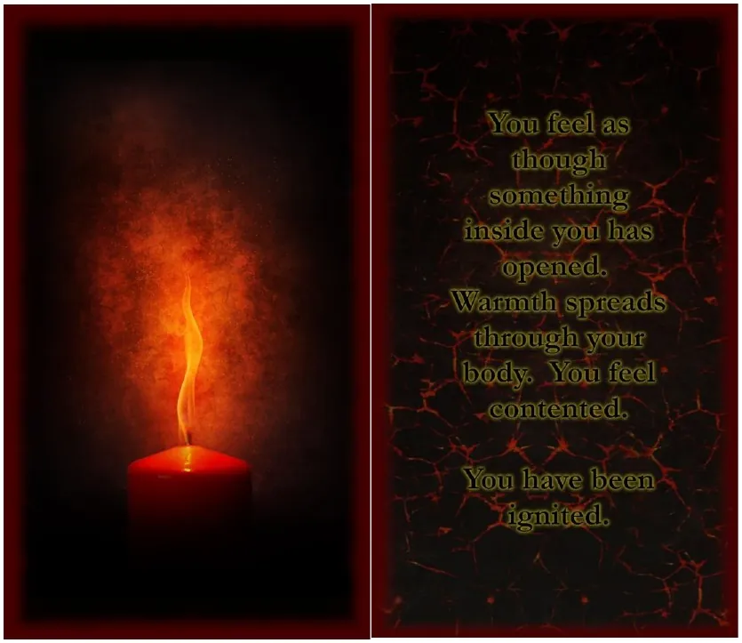

## Раздатка 2. Отмеченный Ктугхой: «Воспламенён»

> **Раздатка 2. Отмеченный Ктугхой: «Воспламенён»**
>
> *Тебе кажется, будто внутри тебя что-то открылось. По телу разливается тепло. Тебе хорошо.*
>
> *Ты воспламенён.*
