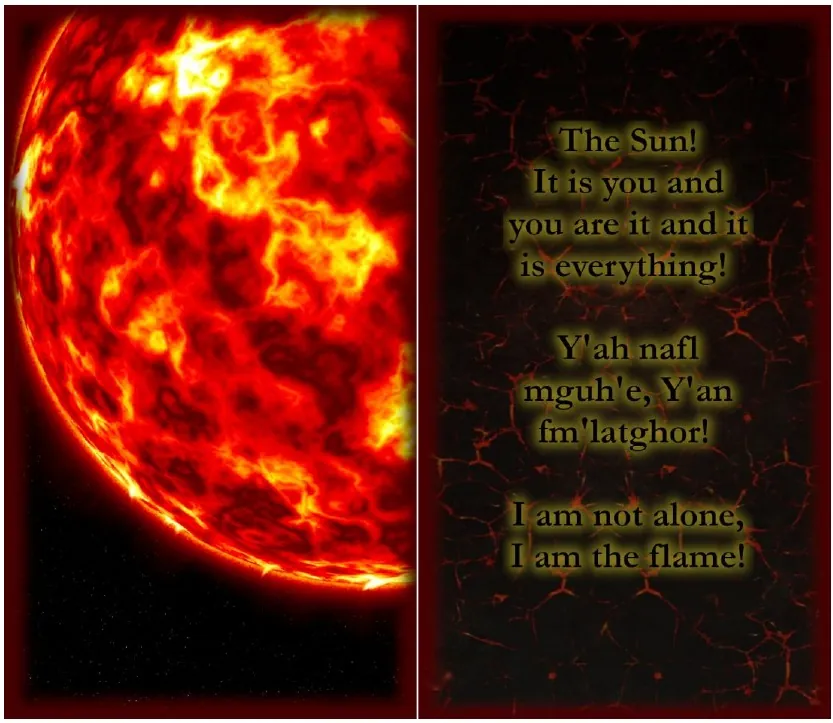

## Раздатка 4. Отмеченный Ктугхой: «Самосожжение»

> **Раздатка 4. Отмеченный Ктугхой: «Самосожжение»**
>
> *Солнце!*  
> *Оно — это ты, а ты — это оно, и оно — всё!*
>
> *Y'ah nafl mguh'e, Y'an fm'latghor!*
>
> *Я не одна, я — пламя!*

*Прим. перев.: на карточке во второй половине фразы напечатано «Y'an» вместо «Y'ah» (ср. с. 7, 10, 14); текст карточки — как напечатан.*
