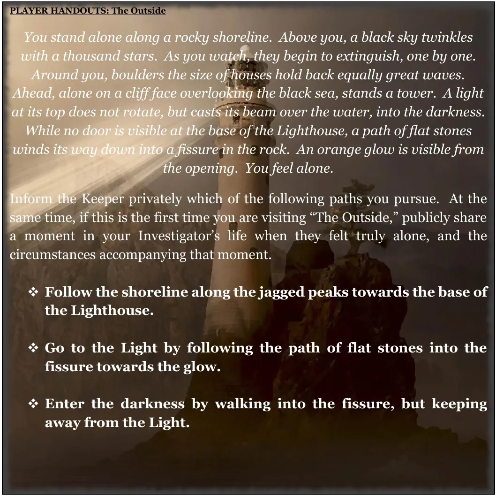

## Раздатка 8. «Снаружи»

> **Раздатка 8. «Снаружи»**
>
> *Ты стоишь один на скалистом берегу. Над тобой мерцает тысячами звёзд чёрное небо. Пока ты смотришь, они начинают гаснуть, одна за другой. Вокруг тебя валуны размером с дом сдерживают такие же огромные волны. Впереди, одна на утёсе над чёрным морем, стоит башня. Свет на её вершине не вращается, а бросает луч над водой, во тьму. Двери у подножия Маяка не видно, но дорожка из плоских камней спускается в расщелину в скале. Из проёма льётся оранжевое сияние. Тебе одиноко.*
>
> *Тайно сообщи Хранителю, какой путь ты выбираешь. И если ты впервые оказался «Снаружи», расскажи всем о моменте в жизни твоего сыщика, когда он почувствовал себя по-настоящему одиноким, и об обстоятельствах этого момента.*
>
> - *Идти вдоль берега по острым скалам к подножию Маяка.*
> - *Идти к Свету по дорожке из плоских камней в расщелину, к сиянию.*
> - *Войти во тьму: спуститься в расщелину, но держаться подальше от Света.*