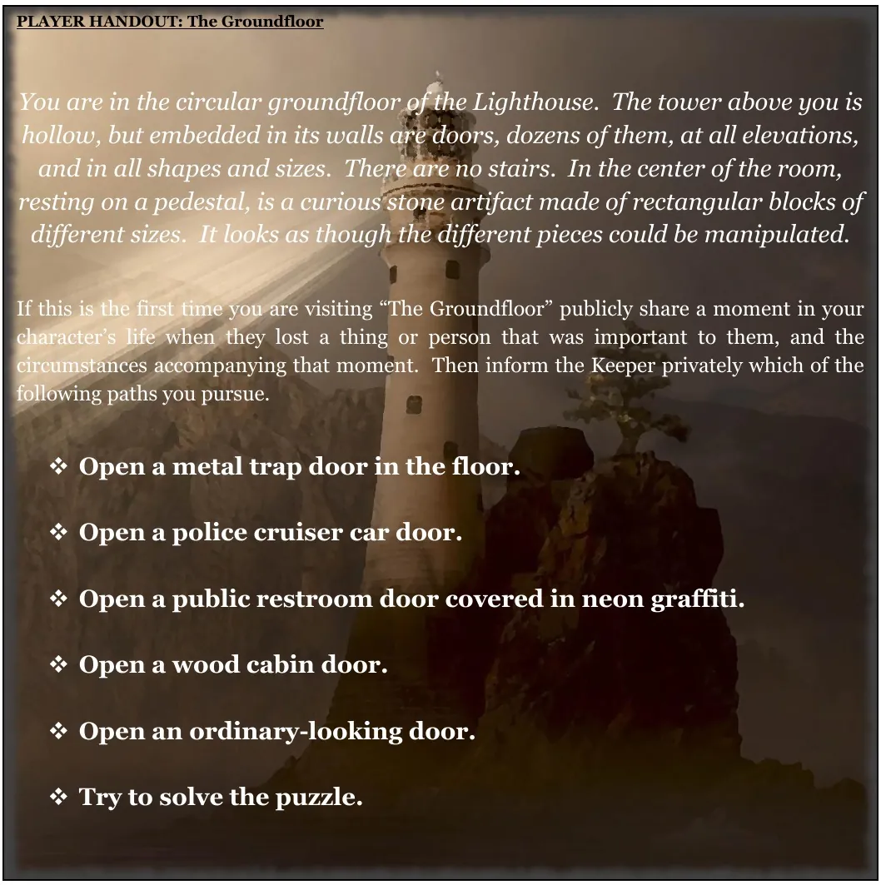

## Раздатка 9. «Первый этаж»

> **Раздатка 9. «Первый этаж»**
>
> *Ты на круглом первом этаже Маяка. Башня над тобой полая, но в её стены встроены двери, десятки дверей, на всех высотах, всех форм и размеров. Лестницы нет. В центре зала на постаменте лежит странный каменный артефакт из прямоугольных блоков разного размера. Похоже, детали можно двигать.*
>
> *Если ты впервые оказался на «Первом этаже», расскажи всем о моменте в жизни твоего персонажа, когда он потерял вещь или человека, который был ему важен, и об обстоятельствах этого момента. Затем тайно сообщи Хранителю, какой путь ты выбираешь.*
>
> - *Открыть металлический люк в полу.*
> - *Открыть дверь полицейской машины.*
> - *Открыть дверь общественного туалета, исписанную неоновыми граффити.*
> - *Открыть дверь бревенчатой хижины.*
> - *Открыть обычную на вид дверь.*
> - *Попробовать решить головоломку.*