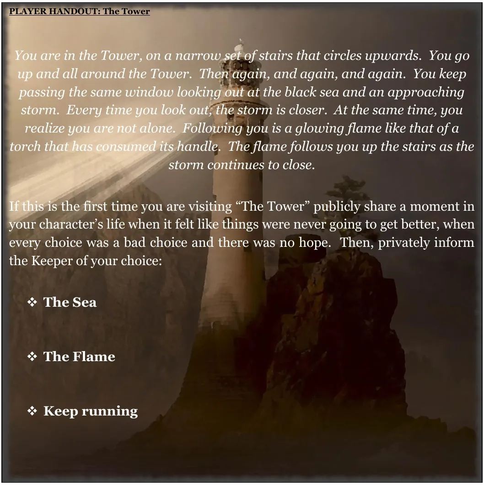

## Раздатка 10. «Башня»

> **Раздатка 10. «Башня»**
>
> *Ты в Башне, на узкой лестнице, что вьётся вверх. Ты поднимаешься, обходя Башню по кругу. Потом снова, и снова, и снова. Ты всё проходишь одно и то же окно, выходящее на чёрное море и надвигающуюся грозу. Каждый раз, когда ты выглядываешь, гроза ближе. И в то же время ты понимаешь, что ты не один. За тобой следует светящееся пламя, как у факела, сгоревшего до рукояти. Пламя идёт за тобой вверх по лестнице, а гроза всё приближается.*
>
> *Если ты впервые оказался в «Башне», расскажи всем о моменте в жизни твоего персонажа, когда казалось, что лучше уже не станет, когда любой выбор был плохим и надежды не было. Затем тайно сообщи Хранителю свой выбор:*
>
> - *Море.*
> - *Пламя.*
> - *Бежать дальше.*