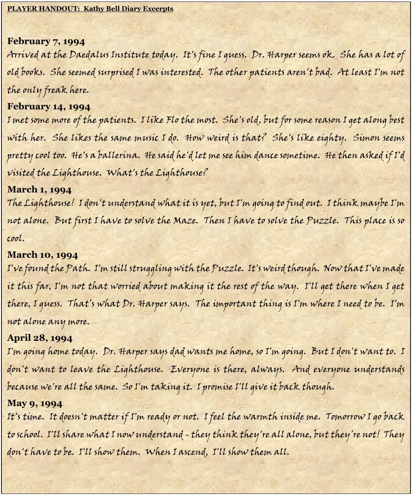

## Раздатка 11. Выдержки из дневника Кэти Белл

> **Раздатка 11. Выдержки из дневника Кэти Белл**
>
> ***7 февраля 1994 года***  
> *Сегодня приехала в институт «Дедал». Вроде нормально. Доктор Харпер, кажется, ничего. У неё куча старых книг. Она вроде удивилась, что мне интересно. Остальные пациенты неплохие. По крайней мере, я тут не единственная чудачка.*
>
> ***14 февраля 1994 года***  
> *Познакомилась ещё с несколькими пациентами. Больше всех мне нравится Фло. Она старая, но почему-то я лучше всего лажу с ней. Ей нравится та же музыка, что и мне. Ну не странно? Ей же лет восемьдесят. Саймон тоже вроде классный. Он балерина. Сказал, что когда-нибудь даст посмотреть, как он танцует. А потом спросил, была ли я на Маяке. Что ещё за Маяк?*
>
> ***1 марта 1994 года***  
> *Маяк! Я пока не понимаю, что это, но я узнаю. Кажется, может быть, я не одна. Но сначала надо решить Лабиринт. Потом надо решить Головоломку. Тут так круто.*
>
> ***10 марта 1994 года***  
> *Я нашла Путь. Всё ещё бьюсь над Головоломкой. Но странно. Теперь, когда я зашла так далеко, я не очень волнуюсь, дойду ли до конца. Дойду, когда дойду, наверное. Так говорит доктор Харпер. Главное — я там, где мне нужно быть. Я больше не одна.*
>
> ***28 апреля 1994 года***  
> *Сегодня еду домой. Доктор Харпер говорит, что папа хочет, чтобы я была дома, так что я еду. Но я не хочу. Я не хочу уходить с Маяка. Там все, всегда. И все понимают, потому что мы все одинаковые. Так что я забираю его с собой. Обещаю, что верну.*
>
> ***9 мая 1994 года***  
> *Пора. Неважно, готова я или нет. Я чувствую тепло внутри. Завтра возвращаюсь в школу. Я поделюсь тем, что теперь понимаю, — они думают, что совсем одни, но это не так! Им не нужно быть одним. Я им покажу. Когда я вознесусь, я покажу им всем.*