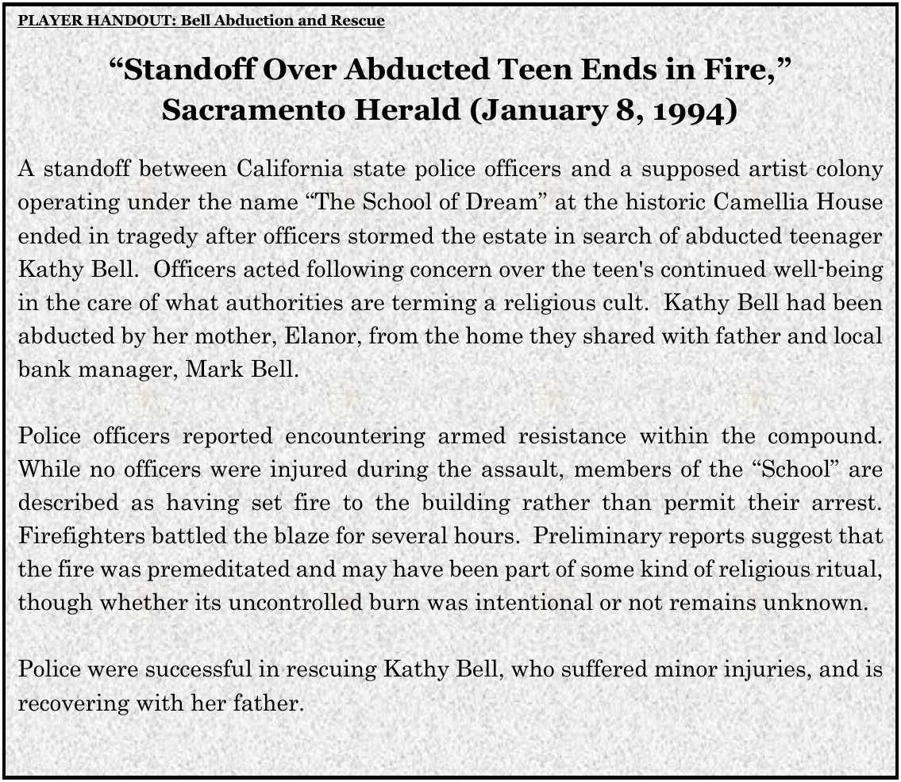

## Раздатка 12. Похищение и спасение Кэти Белл

> **Раздатка 12. Похищение и спасение Кэти Белл**
>
> ***«Осада из-за похищенной девушки закончилась пожаром»***  
> ***«Сакраменто геральд» (8 января 1994 года)***
>
> *Противостояние полиции штата Калифорния и так называемой художественной колонии, действовавшей под названием «Школа Сна» в исторической усадьбе «Камелия», закончилось трагедией: полицейские штурмовали усадьбу в поисках похищенной девушки Кэти Белл. Полиция действовала, опасаясь за благополучие подростка в руках того, что власти называют религиозным культом. Кэти Белл похитила её мать Эленор из дома, где они жили с отцом, управляющим местного банка Марком Беллом.*
>
> *Полицейские сообщили, что внутри комплекса встретили вооружённое сопротивление. Во время штурма никто из полицейских не пострадал, но члены «Школы», по описаниям, подожгли здание, лишь бы не сдаться. Пожарные несколько часов боролись с огнём. По предварительным данным, поджог был спланирован и мог быть частью какого-то религиозного ритуала, хотя было ли неуправляемое пламя намеренным, остаётся неизвестным.*
>
> *Полиции удалось спасти Кэти Белл, получившую лёгкие травмы; она поправляется у отца.*