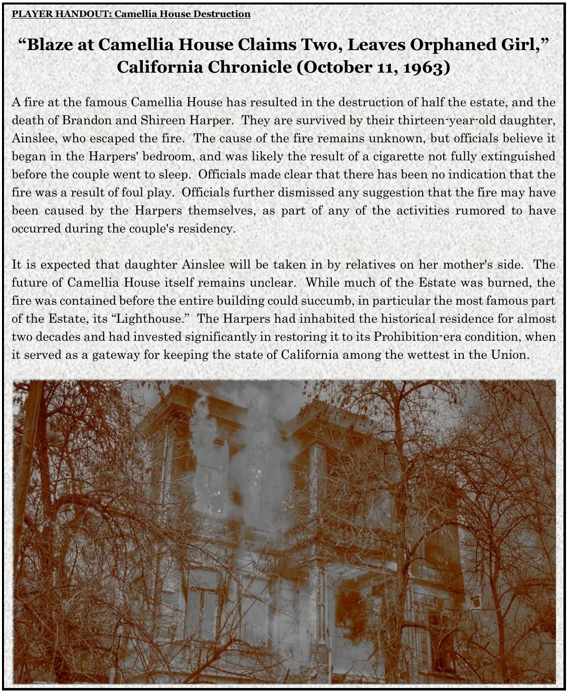

## Раздатка 13. Пожар в усадьбе «Камелия»

> **Раздатка 13. Пожар в усадьбе «Камелия»**
>
> ***«Пожар в усадьбе „Камелия“ унёс две жизни и оставил девочку сиротой»***  
> ***«Калифорния кроникл» (11 октября 1963 года)***
>
> *Пожар в знаменитой усадьбе «Камелия» уничтожил половину поместья и унёс жизни Брэндона и Ширин Харпер. У них осталась тринадцатилетняя дочь Эйнсли, спасшаяся из огня. Причина пожара остаётся неизвестной, но, по мнению официальных лиц, огонь начался в спальне Харперов и, вероятно, возник от непогашенной сигареты, которую супруги оставили, ложась спать. Официальные лица ясно дали понять, что признаков злого умысла нет. Они также отвергли предположения, что пожар могли устроить сами Харперы в ходе каких-либо занятий, о которых ходили слухи, пока супруги жили в усадьбе.*
>
> *Ожидается, что дочь Эйнсли возьмут к себе родственники по материнской линии. Будущее самой «Камелии» неясно. Хотя бо́льшая часть поместья сгорела, огонь удалось остановить прежде, чем он охватил всё здание, — в частности, самую знаменитую часть поместья, его «Маяк». Харперы почти два десятилетия жили в этой исторической резиденции и вложили немало сил в восстановление её облика эпохи сухого закона, когда она служила воротами, благодаря которым Калифорния оставалась одним из самых «мокрых» штатов Союза.*