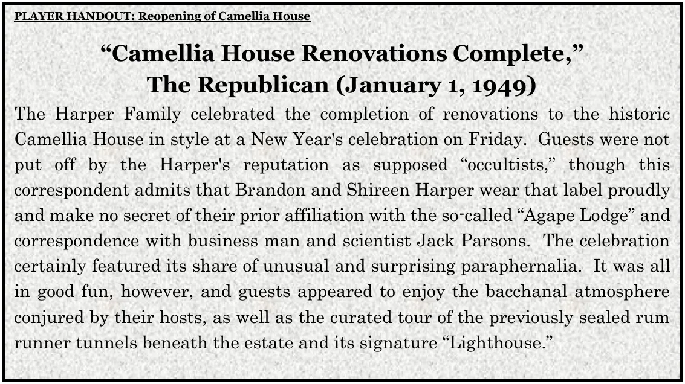

## Раздатка 14. Усадьба «Камелия» вновь открыта

> **Раздатка 14. Усадьба «Камелия» вновь открыта**
>
> ***«Реставрация усадьбы „Камелия“ завершена»***  
> ***«Рипабликан» (1 января 1949 года)***
>
> *Семья Харпер с размахом отметила окончание реставрации исторической усадьбы «Камелия» на новогоднем празднике в пятницу. Гостей не смутила репутация Харперов как так называемых «оккультистов», хотя ваш корреспондент признаёт, что Брэндон и Ширин Харпер носят этот ярлык с гордостью и не скрывают былой связи с так называемой «Ложей Агапе» и переписки с бизнесменом и учёным Джеком Парсонсом. На празднике, безусловно, хватало необычных и удивительных принадлежностей. Но всё это было в шутку, и гостям явно понравилась вакхическая атмосфера, которую создали хозяева, а также экскурсия по ранее запечатанным туннелям бутлегеров под поместьем и по его знаменитому «Маяку».*