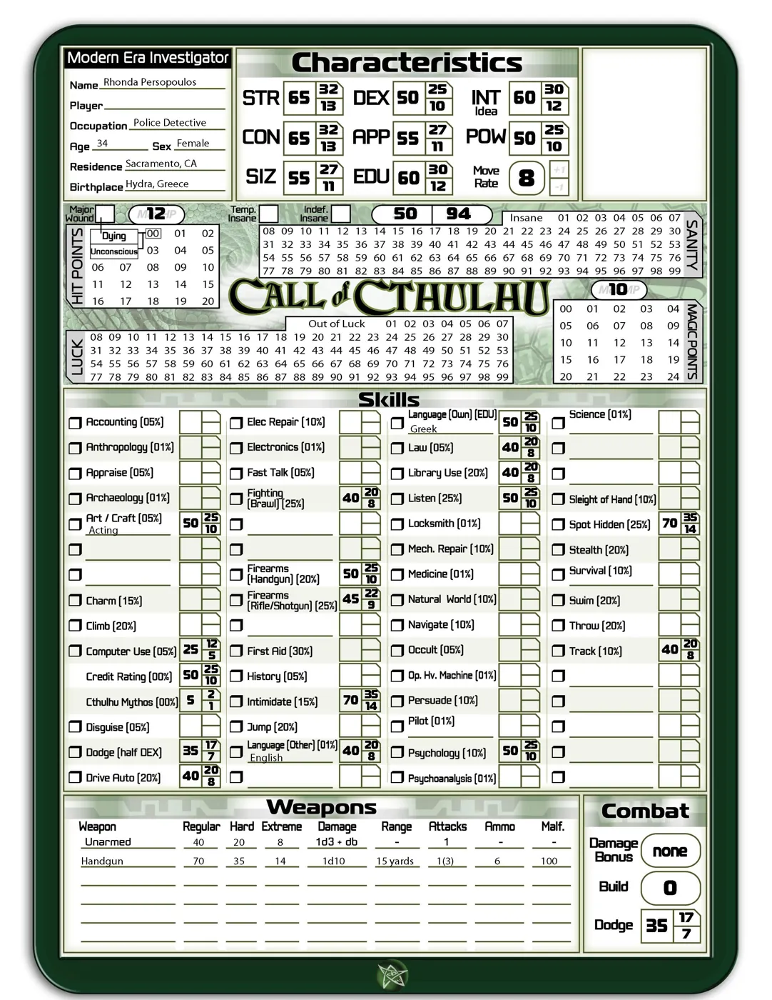

## Лист сыщика: Ронда Персопулос



*Лист сыщика нашего времени (Modern Era Investigator); портрета нет — силуэт. Ниже — перевод листа.*

**Имя:** Ронда Персопулос  
**Профессия:** детектив полиции  
**Возраст:** 34  
**Пол:** женский  
**Место жительства:** Сакраменто, Калифорния  
**Место рождения:** Идра, Греция

```stat
СИЛ 65 (32/13)    ВЫН 65 (32/13)    ТЕЛ 55 (27/11)    ЛВК 50 (25/10)
НАР 55 (27/11)    ИНТ 60 (30/12)    МОЩ 50 (25/10)    ОБР 60 (30/12)

ПЗ 12    ПМ 10    Рассудок 50 (макс. 94)    Удача 60
БкУ: нет    Комплекция: 0    СКО: 8

Навыки:
  Искусство/ремесло (актёрская игра)       50 (25/10)
  Работа с компьютером                     25 (12/5)
  Средства                                 50 (25/10)
  Мифы Ктулху                              5 (2/1)
  Уклонение                                35 (17/7)
  Вождение автомобиля                      40 (20/8)
  Ближний бой (драка)                      40 (20/8)
  Стрельба (пистолет)                      50 (25/10)
  Стрельба (винтовка/дробовик)             45 (22/9)
  Запугивание                              70 (35/14)
  Иностранный язык (английский)            40 (20/8)
  Родной язык (греческий)                  50 (25/10)
  Юриспруденция                            40 (20/8)
  Работа в библиотеке                      40 (20/8)
  Слух                                     50 (25/10)
  Психология                               50 (25/10)
  Внимание                                 70 (35/14)
  Чтение следов                            40 (20/8)

Оружие (обычный / трудный / чрезвычайный, урон, дальность, атак, боезапас, осечка):
  Без оружия     40 / 20 / 8, урон 1d3 + БкУ
  Пистолет       70 / 35 / 14, урон 1d10; дальность 15 м, выстрелов 1 (3), магазин 6, осечка 100

Уклонение 35 (17/7)
```

*Прим. перев.: так на листе — в графе оружия у пистолета 70/35/14, хотя навык Стрельба (пистолет) на том же листе — 50/25/10; Родной язык (греческий) 50 при ОБР 60 (обычно равен ОБР). Оставлено как напечатано.*
