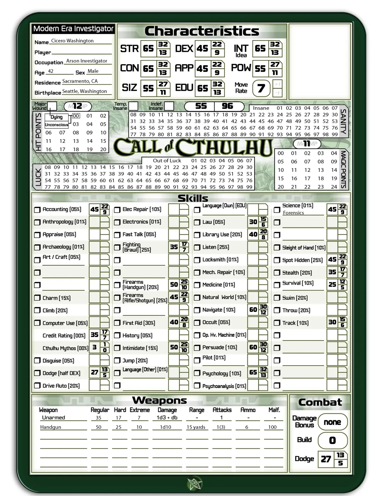

## Лист сыщика: Сисеро Вашингтон



*Лист сыщика нашего времени (Modern Era Investigator); портрета нет — силуэт. Ниже — перевод листа.*

**Имя:** Сисеро Вашингтон  
**Профессия:** дознаватель по поджогам пожарного департамента  
**Возраст:** 42  
**Пол:** мужской  
**Место жительства:** Сакраменто, Калифорния  
**Место рождения:** Сиэтл, Вашингтон

```stat
СИЛ 65 (32/13)    ВЫН 65 (32/13)    ТЕЛ 55 (27/11)    ЛВК 45 (22/9)
НАР 45 (22/9)    ИНТ 65 (32/13)    МОЩ 55 (27/11)    ОБР 65 (32/13)

ПЗ 12    ПМ 11    Рассудок 55 (макс. 96)    Удача 60
БкУ: нет    Комплекция: 0    СКО: 7

Навыки:
  Бухгалтерское дело                       45 (22/9)
  Средства                                 35 (17/7)
  Мифы Ктулху                              3 (1/0)
  Уклонение                                27 (13/5)
  Ближний бой (драка)                      35 (17/7)
  Стрельба (пистолет)                      50 (25/10)
  Стрельба (винтовка/дробовик)             45 (22/9)
  Первая помощь                            40 (20/8)
  Запугивание                              50 (25/10)
  Юриспруденция                            30 (15/6)
  Работа в библиотеке                      40 (20/8)
  Ориентирование                           60 (30/12)
  Убеждение                                60 (30/12)
  Психология                               65 (32/13)
  Наука (криминалистика)                   45 (22/9)
  Внимание                                 45 (22/9)
  Скрытность                               35 (17/7)
  Выживание                                25 (12/5)
  Чтение следов                            30 (15/6)

Оружие (обычный / трудный / чрезвычайный, урон, дальность, атак, боезапас, осечка):
  Без оружия     35 / 17 / 7, урон 1d3 + БкУ
  Пистолет       50 / 25 / 10, урон 1d10; дальность 15 м, выстрелов 1 (3), магазин 6, осечка 100

Уклонение 27 (13/5)
```
