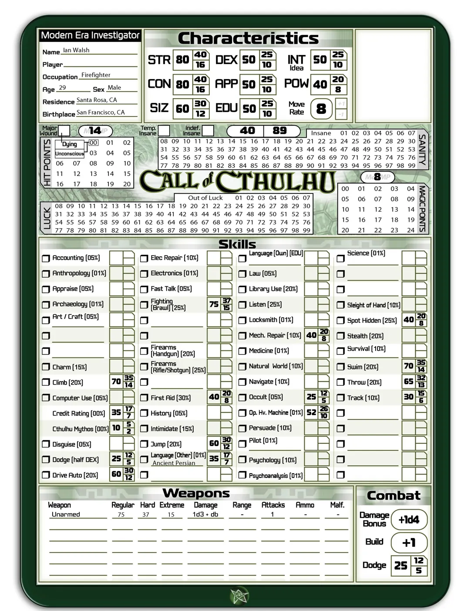

## Лист сыщика: Иэн Уолш



*Лист сыщика нашего времени (Modern Era Investigator); портрета нет — силуэт. Ниже — перевод листа.*

**Имя:** Иэн Уолш  
**Профессия:** пожарный  
**Возраст:** 29  
**Пол:** мужской  
**Место жительства:** Санта-Роза, Калифорния  
**Место рождения:** Сан-Франциско, Калифорния

```stat
СИЛ 80 (40/16)    ВЫН 80 (40/16)    ТЕЛ 60 (30/12)    ЛВК 50 (25/10)
НАР 50 (25/10)    ИНТ 50 (25/10)    МОЩ 40 (20/8)    ОБР 50 (25/10)

ПЗ 14    ПМ 8    Рассудок 40 (макс. 89)    Удача 60
БкУ: +1d4    Комплекция: 1    СКО: 8

Навыки:
  Лазание                                  70 (35/14)
  Средства                                 35 (17/7)
  Мифы Ктулху                              10 (5/2)
  Уклонение                                25 (12/5)
  Вождение автомобиля                      60 (30/12)
  Ближний бой (драка)                      75 (37/15)
  Первая помощь                            40 (20/8)
  Прыжки                                   60 (30/12)
  Иностранный язык (древнеперсидский)      35 (17/7)
  Механика                                 40 (20/8)
  Оккультизм                               25 (12/5)
  Управление тяжёлыми машинами             52 (26/10)
  Внимание                                 40 (20/8)
  Плавание                                 70 (35/14)
  Метание                                  65 (32/13)
  Чтение следов                            30 (15/6)

Оружие (обычный / трудный / чрезвычайный, урон, дальность, атак, боезапас, осечка):
  Без оружия     75 / 37 / 15, урон 1d3 + БкУ

Уклонение 25 (12/5)
```
