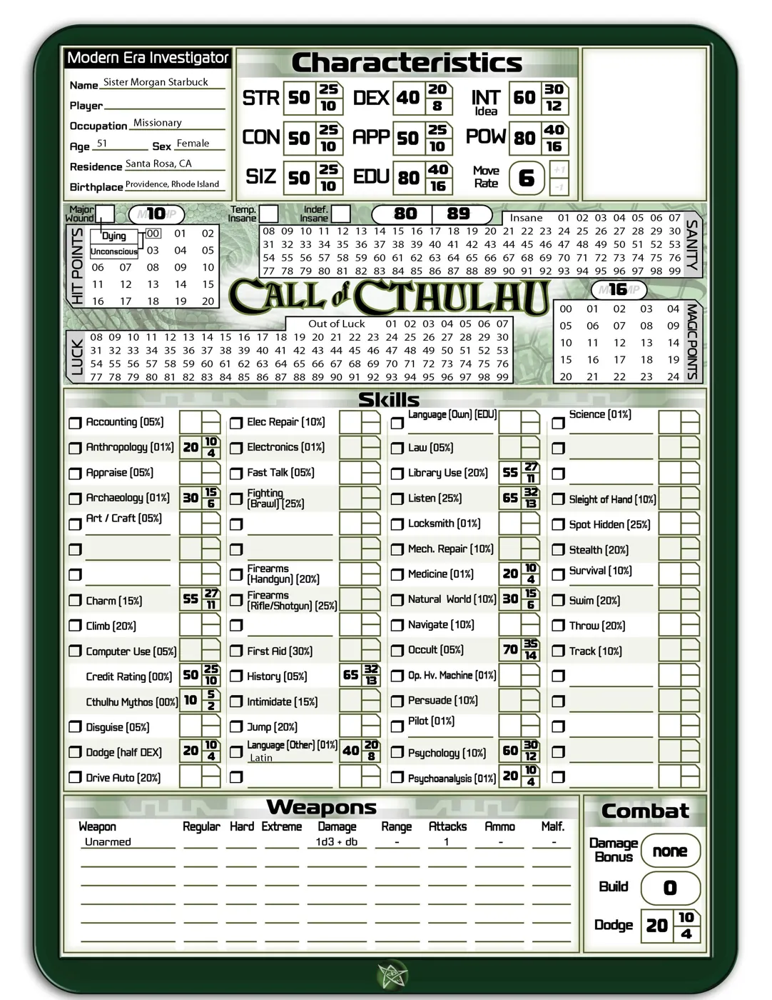

## Лист сыщика: Сестра Морган Старбак



*Лист сыщика нашего времени (Modern Era Investigator); портрета нет — силуэт. Ниже — перевод листа.*

**Имя:** Морган Старбак  
**Профессия:** миссионер, монахиня  
**Возраст:** 51  
**Пол:** женский  
**Место жительства:** Санта-Роза, Калифорния  
**Место рождения:** Провиденс, Род-Айленд

```stat
СИЛ 50 (25/10)    ВЫН 50 (25/10)    ТЕЛ 50 (25/10)    ЛВК 40 (20/8)
НАР 50 (25/10)    ИНТ 60 (30/12)    МОЩ 80 (40/16)    ОБР 80 (40/16)

ПЗ 10    ПМ 16    Рассудок 80 (макс. 89)    Удача 60
БкУ: нет    Комплекция: 0    СКО: 6

Навыки:
  Антропология                             20 (10/4)
  Археология                               30 (15/6)
  Обаяние                                  55 (27/11)
  Средства                                 50 (25/10)
  Мифы Ктулху                              10 (5/2)
  Уклонение                                20 (10/4)
  История                                  65 (32/13)
  Иностранный язык (латынь)                40 (20/8)
  Работа в библиотеке                      55 (27/11)
  Слух                                     65 (32/13)
  Медицина                                 20 (10/4)
  Естествознание                           30 (15/6)
  Оккультизм                               70 (35/14)
  Психология                               60 (30/12)
  Психоанализ                              20 (10/4)

Оружие (обычный / трудный / чрезвычайный, урон, дальность, атак, боезапас, осечка):
  Без оружия     — (не вписан), урон 1d3 + БкУ; шанс в графе оружия не вписан (базовый навык 25%)

Уклонение 20 (10/4)
```
