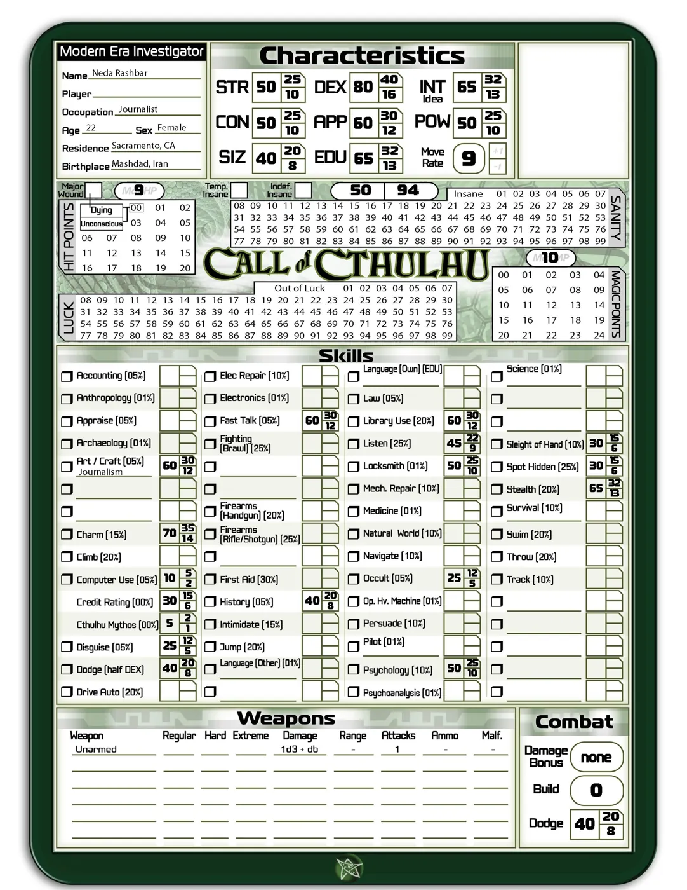

## Лист сыщика: Неда Рашбар



*Лист сыщика нашего времени (Modern Era Investigator); портрета нет — силуэт. Ниже — перевод листа.*

**Имя:** Неда Рашбар  
**Профессия:** журналистка  
**Возраст:** 22  
**Пол:** женский  
**Место жительства:** Сакраменто, Калифорния  
**Место рождения:** Мешхед, Иран

```stat
СИЛ 50 (25/10)    ВЫН 50 (25/10)    ТЕЛ 40 (20/8)    ЛВК 80 (40/16)
НАР 60 (30/12)    ИНТ 65 (32/13)    МОЩ 50 (25/10)    ОБР 65 (32/13)

ПЗ 9    ПМ 10    Рассудок 50 (макс. 94)    Удача 60
БкУ: нет    Комплекция: 0    СКО: 9

Навыки:
  Искусство/ремесло (журналистика)         60 (30/12)
  Обаяние                                  70 (35/14)
  Работа с компьютером                     10 (5/2)
  Средства                                 30 (15/6)
  Мифы Ктулху                              5 (2/1)
  Маскировка                               25 (12/5)
  Уклонение                                40 (20/8)
  Красноречие                              60 (30/12)
  История                                  40 (20/8)
  Работа в библиотеке                      60 (30/12)
  Слух                                     45 (22/9)
  Взлом                                    50 (25/10)
  Оккультизм                               25 (12/5)
  Психология                               50 (25/10)
  Ловкость рук                             30 (15/6)
  Внимание                                 30 (15/6)
  Скрытность                               65 (32/13)

Оружие (обычный / трудный / чрезвычайный, урон, дальность, атак, боезапас, осечка):
  Без оружия     — (не вписан), урон 1d3 + БкУ; шанс в графе оружия не вписан (базовый навык 25%)

Уклонение 40 (20/8)
```

*Прим. перев.: место рождения на листе — «Mashdad, Iran» (так в оригинале); имеется в виду Мешхед.*
