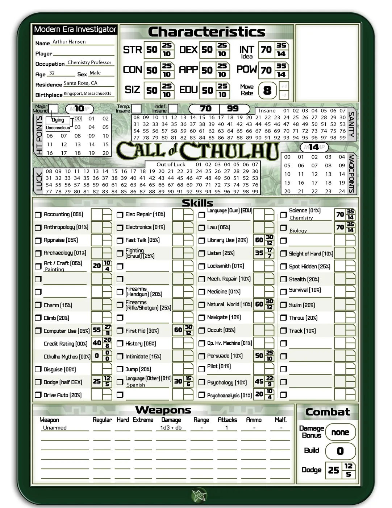

## Лист сыщика: Артур Хансен



*Лист сыщика нашего времени (Modern Era Investigator); портрета нет — силуэт. Ниже — перевод листа.*

**Имя:** Артур Хансен  
**Профессия:** профессор химии колледжа Кроули  
**Возраст:** 32  
**Пол:** мужской  
**Место жительства:** Санта-Роза, Калифорния  
**Место рождения:** Кингспорт, Массачусетс

```stat
СИЛ 50 (25/10)    ВЫН 50 (25/10)    ТЕЛ 50 (25/10)    ЛВК 50 (25/10)
НАР 50 (25/10)    ИНТ 70 (35/14)    МОЩ 70 (35/14)    ОБР 50 (25/10)

ПЗ 10    ПМ 14    Рассудок 70 (макс. 99)    Удача 60
БкУ: нет    Комплекция: 0    СКО: 8

Навыки:
  Искусство/ремесло (живопись)             20 (10/4)
  Работа с компьютером                     55 (27/11)
  Средства                                 40 (20/8)
  Мифы Ктулху                              0 (0/0)
  Уклонение                                25 (12/5)
  Первая помощь                            60 (30/12)
  Иностранный язык (испанский)             30 (15/6)
  Работа в библиотеке                      60 (30/12)
  Слух                                     35 (17/7)
  Естествознание                           60 (30/12)
  Убеждение                                50 (25/10)
  Психология                               45 (22/9)
  Психоанализ                              20 (10/4)
  Наука (химия)                            70 (35/14)
  Наука (биология)                         70 (35/14)

Оружие (обычный / трудный / чрезвычайный, урон, дальность, атак, боезапас, осечка):
  Без оружия     — (не вписан), урон 1d3 + БкУ; шанс в графе оружия не вписан (базовый навык 25%)

Уклонение 25 (12/5)
```
