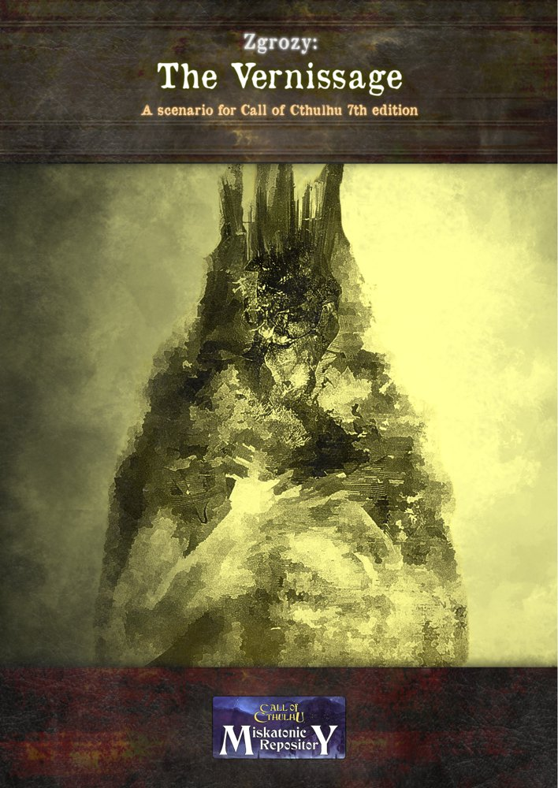

Zgrozy

ВЕРНИСАЖ

Сценарий для «Зова Ктулху» 7-й редакции

*На обложке (художник — Piotr Koziol) — размытая бледная фигура в высокой короне-венце с рукой у груди на жёлтом фоне; вверху — надпись «Zgrozy: The Vernissage. A scenario for Call of Cthulhu 7th edition», внизу — логотип «Call of Cthulhu — Miskatonic Repository».*
