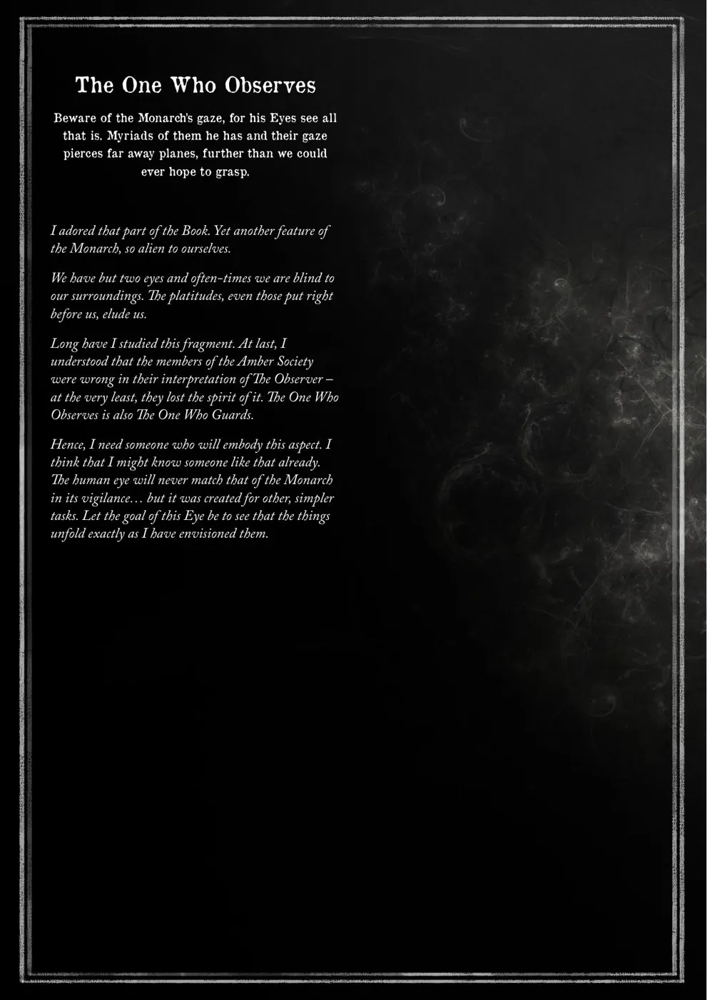

> **Раздатка: Записка Артомовского о Наблюдателе**
>
> **Тот, кто наблюдает**
>
> *Берегитесь взора Монарха, ибо Очи его видят всё сущее. Мириады их у него, и взор их пронзает далёкие планы бытия — дальше, чем мы могли бы надеяться постичь.*
>
> Я полюбил эту часть Книги. Ещё одна черта Монарха, столь чуждая нам.
>
> У нас всего два глаза, и зачастую мы слепы к тому, что нас окружает. Банальности, даже те, что лежат прямо перед нами, ускользают от нас.
>
> Долго я изучал этот отрывок. Наконец я понял, что члены Янтарного общества ошибались в толковании Наблюдателя — по меньшей мере, они утратили его дух. Тот, кто наблюдает, — это и Тот, кто стережёт.
>
> Поэтому мне нужен тот, кто воплотит этот аспект. Думаю, такого человека я, возможно, уже знаю. Человеческому глазу никогда не сравниться с оком Монарха в бдительности… но он создан для других, более простых задач. Пусть цель этого Ока — следить, чтобы всё шло в точности так, как я задумал.
