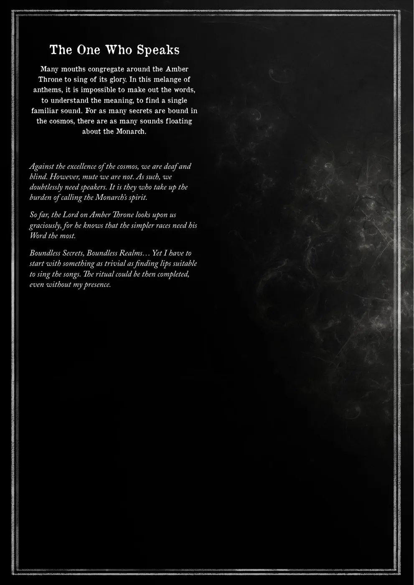

> **Раздатка: Записка Артомовского о Глашатае**
>
> **Тот, кто вещает**
>
> *Множество уст собирается вокруг Янтарного трона, чтобы воспевать его славу. В этой мешанине гимнов невозможно разобрать слова, понять смысл, найти хоть один знакомый звук. Сколько тайн заключено в космосе, столько и звуков витает вокруг Монарха.*
>
> Перед совершенством космоса мы глухи и слепы. Но мы не немы. А значит, нам, несомненно, нужны глашатаи. Именно они берут на себя бремя призыва духа Монарха.
>
> Пока что Владыка на Янтарном троне взирает на нас милостиво, ибо знает, что простейшим расам его Слово нужнее всего.
>
> Безграничные Тайны, Безграничные Царства… А начинать мне приходится с такой мелочи, как поиск уст, способных петь песни. Тогда ритуал можно будет завершить даже без меня.
