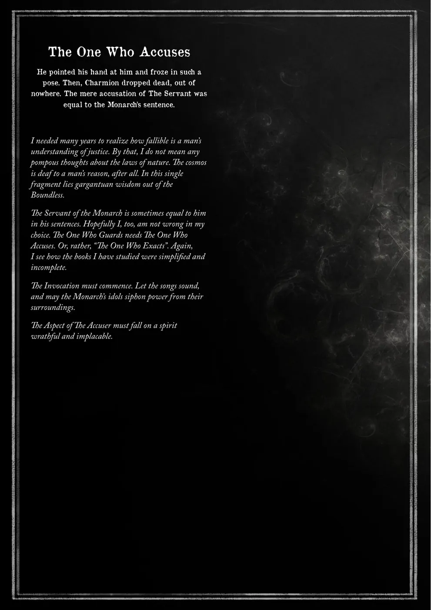

> **Раздатка: Письмо Артомовского об Обвинителе**
>
> **Тот, кто обвиняет**
>
> *Он указал на него рукой и застыл в этой позе. И тогда Хармион ни с того ни с сего настигла смерть. Одно лишь обвинение Слуги было равно приговору Монарха.*
>
> Мне понадобилось много лет, чтобы понять, сколь ошибочно человеческое понимание справедливости. Я говорю не о высокопарных рассуждениях о законах природы: космос, в конце концов, глух к человеческому разуму. В этом единственном отрывке заключена исполинская мудрость, пришедшая из Безграничного.
>
> Слуга Монарха порой равен ему в своих приговорах. Надеюсь, и я не ошибусь в выборе. Тому, кто стережёт, нужен Тот, кто обвиняет. Или, вернее, «Тот, кто взыскивает». Снова я вижу, насколько упрощены и неполны книги, которые я изучал.
>
> Воззвание должно начаться. Пусть звучат песни, и пусть идолы Монарха вытягивают силу из всего вокруг.
>
> Аспект Обвинителя должен пасть на дух гневный и неумолимый.
