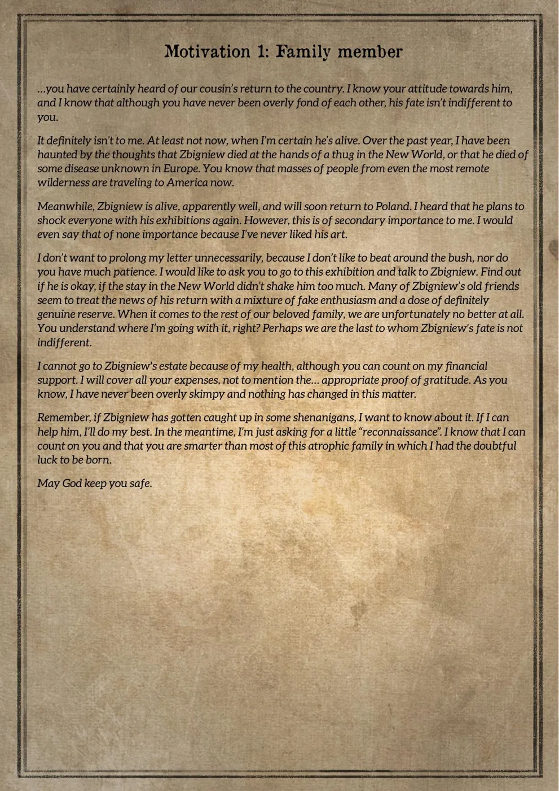

> **Раздатка: Мотивация 1: родственник**
>
> …ты, конечно, слышал о возвращении нашего кузена на родину. Я знаю твоё отношение к нему и знаю, что, хотя вы никогда особенно не любили друг друга, его судьба тебе не безразлична.
>
> Мне — точно не безразлична. По крайней мере не теперь, когда я уверен, что он жив. Весь прошлый год меня преследовали мысли, что Збигнев погиб от руки какого-нибудь бандита в Новом Свете или умер от болезни, неизвестной в Европе. Ты знаешь, что сейчас в Америку едут толпы людей даже из самых глухих углов.
>
> Между тем Збигнев жив, по-видимому, здоров и скоро вернётся в Польшу. Я слышал, что он собирается снова шокировать всех своими выставками. Впрочем, для меня это дело второстепенное. Я бы даже сказал — никакое, потому что мне никогда не нравилось его искусство.
>
> Не хочу затягивать письмо без нужды: я не люблю ходить вокруг да около, да и у тебя не много терпения. Я хотел бы попросить тебя пойти на эту выставку и поговорить со Збигневом. Узнай, в порядке ли он, не слишком ли потрясло его пребывание в Новом Свете. Многие старые друзья Збигнева, кажется, встречают весть о его возвращении смесью притворного восторга и изрядной доли вполне искренней сдержанности. Что до остальной нашей любимой семьи, мы, к сожалению, ничуть не лучше. Ты ведь понимаешь, к чему я клоню? Может быть, мы последние, кому судьба Збигнева не безразлична.
>
> Я не могу поехать в усадьбу Збигнева из-за здоровья, но ты можешь рассчитывать на мою финансовую поддержку. Я покрою все твои расходы, не говоря уже о… соответствующем знаке благодарности. Как ты знаешь, я никогда не был особенно скуп, и в этом ничего не изменилось.
>
> Помни: если Збигнев впутался в какие-то тёмные делишки, я хочу об этом знать. Если я смогу ему помочь, я сделаю всё, что в моих силах. А пока я прошу лишь о небольшой «разведке». Я знаю, что могу на тебя рассчитывать и что ты умнее большинства в этой захиревшей семье, в которой мне выпало сомнительное счастье родиться.
>
> Храни тебя Бог.
