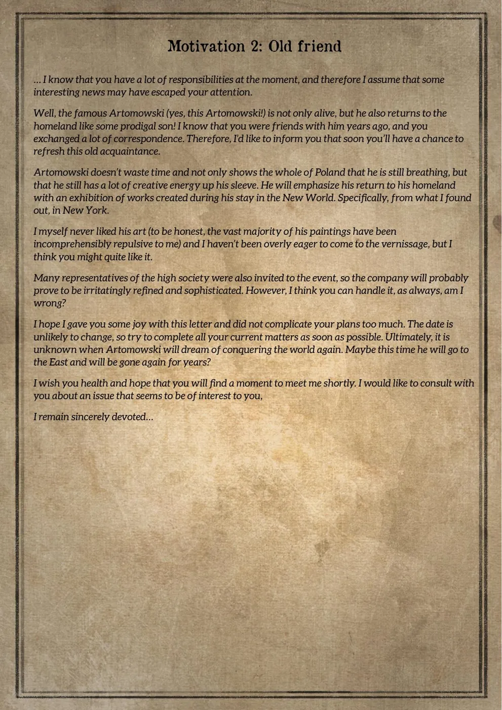

> **Раздатка: Мотивация 2: старый друг**
>
> …я знаю, что у тебя сейчас много обязанностей, и потому полагаю, что некоторые интересные новости могли ускользнуть от твоего внимания.
>
> Так вот, знаменитый Артомовский (да-да, тот самый Артомовский!) не только жив, но и возвращается на родину, словно блудный сын! Я знаю, что много лет назад вы дружили и много переписывались. Поэтому хочу сообщить, что скоро у тебя будет случай освежить это старое знакомство.
>
> Артомовский не теряет времени и показывает всей Польше не только то, что он ещё дышит, но и то, что творческой энергии у него в запасе ещё хоть отбавляй. Своё возвращение на родину он отметит выставкой работ, созданных во время пребывания в Новом Свете. А именно, насколько я узнал, в Нью-Йорке.
>
> Мне самому его искусство никогда не нравилось (честно говоря, подавляющее большинство его картин казались мне непостижимо отталкивающими), и я не особенно рвусь на вернисаж, но думаю, тебе он может вполне понравиться.
>
> На мероприятие пригласили и многих представителей высшего общества, так что компания, вероятно, окажется раздражающе утончённой и изысканной. Впрочем, думаю, ты справишься, как всегда, — или я ошибаюсь?
>
> Надеюсь, я доставил тебе немного радости этим письмом и не слишком спутал твои планы. Дата вряд ли изменится, так что постарайся поскорее закончить все текущие дела. В конце концов, неизвестно, когда Артомовскому снова приснится покорение мира. Может, на этот раз он отправится на Восток и опять пропадёт на годы?
>
> Желаю тебе здоровья и надеюсь, что ты найдёшь минутку вскоре со мной встретиться. Я хотел бы посоветоваться с тобой по делу, которое, кажется, тебя интересует,
>
> остаюсь искренне преданный…
