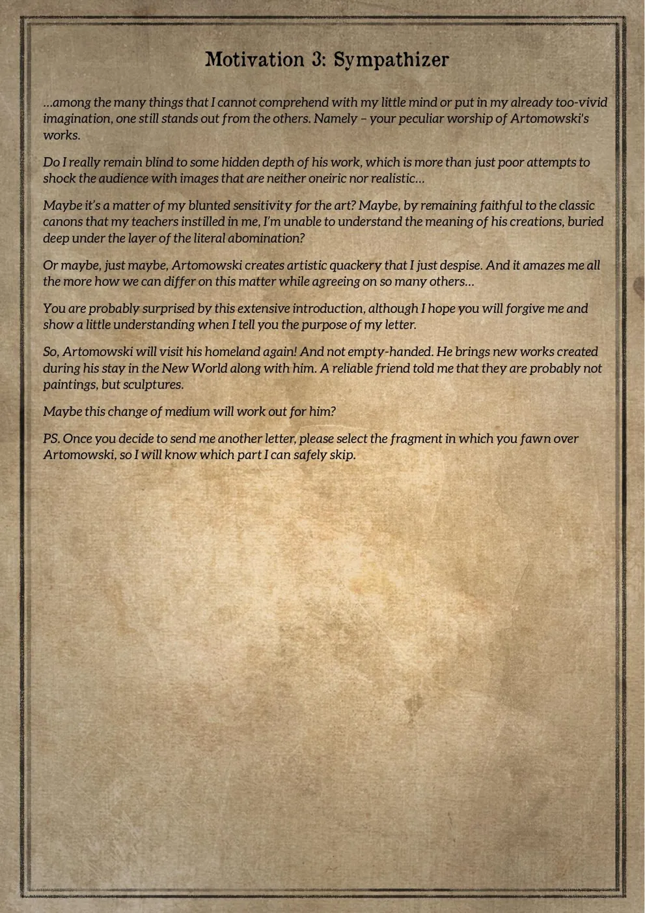

> **Раздатка: Мотивация 3: сочувствующий**
>
> …среди множества вещей, которые я не могу постичь своим скромным умом или уместить в своём и без того слишком живом воображении, одна по-прежнему выделяется среди прочих. А именно — твоё своеобразное поклонение работам Артомовского.
>
> Неужели я и вправду остаюсь слеп к какой-то скрытой глубине его творчества, которое для меня не более чем жалкие попытки шокировать публику образами, ни сновидческими, ни реалистичными…
>
> Может быть, дело в моей притупившейся чувствительности к искусству? Может быть, храня верность классическим канонам, привитым мне учителями, я не способен понять смысл его творений, погребённый глубоко под слоем буквальной мерзости?
>
> А может быть, всего лишь может быть, Артомовский творит художественное шарлатанство, которое я попросту презираю. И тем больше меня поражает, как мы можем расходиться в этом, соглашаясь во многом другом…
>
> Ты, вероятно, удивлён столь пространным вступлением, но надеюсь, ты простишь меня и проявишь немного понимания, когда я скажу, зачем пишу.
>
> Итак, Артомовский снова посетит родину! И не с пустыми руками. Он везёт с собой новые работы, созданные во время пребывания в Новом Свете. Надёжный друг сказал мне, что это, вероятно, не картины, а скульптуры.
>
> Может быть, смена материала пойдёт ему на пользу?
>
> P. S. Когда решишь написать мне ещё одно письмо, пожалуйста, отметь отрывок, где ты расточаешь похвалы Артомовскому, чтобы я знал, какую часть можно смело пропустить.
