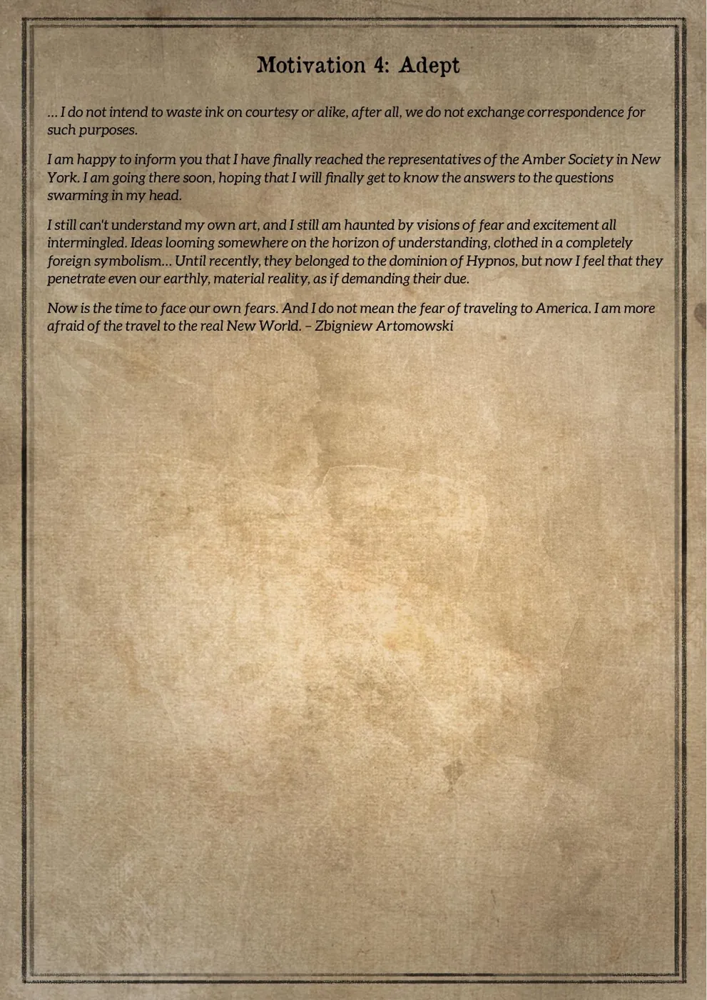

> **Раздатка: Мотивация 4: Адепт**
>
> …Я не намерен тратить чернила на любезности и тому подобное — в конце концов, мы переписываемся не для этого.
>
> Рад сообщить, что я наконец связался с представителями Янтарного общества в Нью-Йорке. Скоро я еду туда в надежде наконец узнать ответы на вопросы, роящиеся в моей голове.
>
> Я до сих пор не могу понять собственного искусства, и меня по-прежнему преследуют видения, в которых перемешаны страх и восторг. Идеи, маячащие где-то на горизонте понимания, облачённые в совершенно чуждую символику… Ещё недавно они принадлежали владениям Гипноса, но теперь я чувствую, что они проникают даже в нашу земную, материальную действительность, словно требуя своего.
>
> Пора взглянуть в лицо собственным страхам. И я говорю не о страхе перед поездкой в Америку. Больше я боюсь путешествия в настоящий Новый Свет. — Збигнев Артомовский
