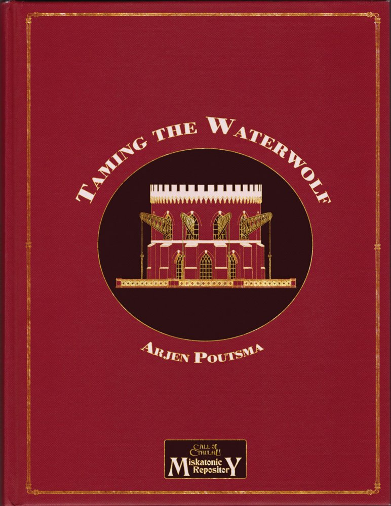

УКРОЩЕНИЕ ВОДЯНОГО ВОЛКА

Арьен Поутсма

*На обложке — красный переплёт с золотой рамкой; в тёмном круге — неоготическая паровая насосная станция с балансирами; по дуге — название «Taming the Waterwolf», ниже — имя автора (Arjen Poutsma) и логотип «Call of Cthulhu — Miskatonic Repository».*
