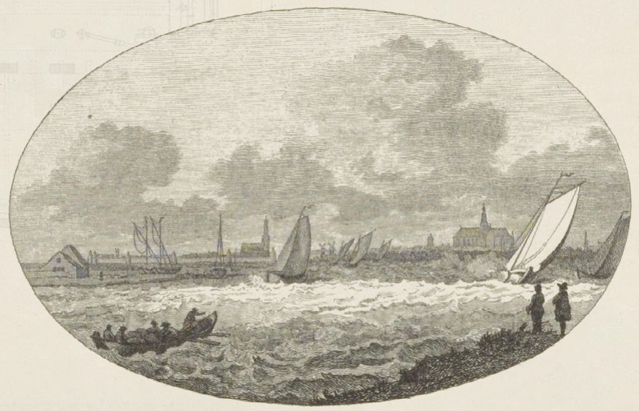

# Оглавление

| Раздел | Стр. |
|---|---|
| **Предыстория для Хранителя** | 4 |
| — Нидерланды в апреле 1849 года | 4 |
| **Действующие лица** | 5 |
| Главные персонажи | 5 |
| Второстепенные персонажи | 6 |
| — Джон Нилл | 6 |
| — Нидерландские имена | 7 |
| **Сыщики** | 8 |
| — Раздатка 2: Жестокий Водяной волк | 8 |
| — Хронология | 8 |
| **Линден** | 10 |
| Насосная станция Линден | 10 |
| — Изучение знаков | 12 |
| Поиски Геррита де Вита | 13 |
| — Расследование о «Драгон Рохо» | 14 |
| — Водяная камера Распхёйса | 15 |
| Итоги | 15 |
| **Лехватер** | 16 |
| Насосная станция Лехватер | 16 |
| Кааг | 17 |
| **Круквиус** | 22 |
| Насосная станция Круквиус | 22 |
| Контора | 22 |
| — Раздатка 8: Пробуждение дракона | 24 |
| — Раздатка 10: выдержки из «Путеводителя для путешественников по Девону и Корнуоллу» | 24 |
| — Раздатка 9: анонимное письмо | 24 |
| — Раздатка 11: письмо Эдварду Ниллу | 24 |
| Жильё рабочих | 25 |
| **Развязка** | 26 |
| Снова в туман | 26 |
| Открытие станции Круквиус | 28 |
| Заключение | 30 |
| **Приложение A: персонажи и чудовища** | 31 |
| **Приложение B: раздатки для игроков** | 34 |
| **Приложение C: заклинания** | 40 |
| **Приложение D: готовые сыщики** | 41 |

*Номера страниц — по оригиналу (в подвале каждой страницы перевода).*

