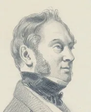
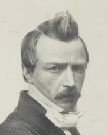
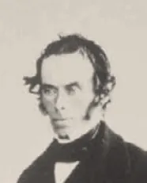

Подчинив девушку своей воле, оно приказало ей напасть на станцию Лехватер, но та не справилась, и отец запер её под замок. Когда заработала вторая станция, ллойгор подчинил себе Геррита де Вита, рыбака из Слотена, и тот в ночь перед тем, как к сыщикам обращаются за помощью, устроил диверсию на станции Линден.

# Действующие лица

Характеристики персонажей и чудовищ приведены в приложении A «Персонажи и чудовища», с. 31.

## Главные персонажи

### Йонкхер Даниэль Теодор Геверс ван Эндегест

*56 лет, политик и председатель комитета по осушению*

Йонкхер (эсквайр) Геверс ван Эндегест — известный политик-консерватор, член Второй палаты (Tweede Kamer, букв. «Вторая палата» — палата представителей). Как председатель Комитета по управлению и надзору за осушением Харлеммермера, он в конечном счёте отвечает за успех всего дела. Повседневное руководство йонкхер по большей части оставляет ван Кортландту, чей отец — его товарищ-консерватор. Он живёт с женой Маргаретой, которая временами страдает нервными срывами, в особняке замка Хемстеде, недалеко от станции Круквиус. Детей у супругов нет.

- **Внешность:** лысеющий, с седеющими волосами и бакенбардами. Худощавого сложения, носит старомодные фраки и жилеты. Тонкие губы обычно опущены уголками вниз — особенно когда он говорит с простолюдинами.
- **Черты:** трезвый, приверженный традициям, сдержанный.
- **Отыгрыш:** Геверс ван Эндегест обращается к сыщикам, чтобы они раскрыли диверсию на Линдене. Сыщики из высшего или среднего класса могут быть его знакомыми. Когда диверсант пойман, йонкхер приглашает сыщиков на торжественное открытие последней станции. Он может также рассказать им о ван Кортландте и о его прежних поездках в Японию.

### Виллем ван Кортландт

*54 года, инженер-механик и колдун*

Виллем ван Кортландт — главный инженер осушения и главный противник сыщиков в этом сценарии.

Отец ван Кортландта — член палаты представителей — хотел, чтобы Виллем стал политиком или юристом. Вместо этого тот решил изучать механику в Англии. Там, через одно оккультное общество, он впервые столкнулся с Мифами. Окончив учёбу, ван Кортландт поступил на службу в Нидерландское торговое общество (Nederlandsche Handel-Maatschappij); эта работа приводила его в самые отдалённые колонии и фактории Нидерландов. Среди прочих мест он побывал на Дэдзиме — единственной европейской фактории, которой разрешили работать в Японии в годы её изоляции; там он преподавал инженерное дело в рамках обмена знаниями рангаку. Через одного из своих японских учеников он случайно заполучил несколько страниц из «Книги мифов и легенд Японии» (см. «Secrets of Japan», с. 132) — японской книги Мифов. Вскоре после этого ван Кортландт вернулся в Нидерланды, где со временем его назначили главным инженером осушения Харлеммермера.

С тех пор как он вернулся, ван Кортландту удалось перевести несколько заклинаний, скрытых в японской книге. Одно позволило ему дышать под водой, другое — ощутить присутствие древнего ллойгора, спящего под водами озера. Ван Кортландт стал одержим могучим существом и уверился, что оно даст ему огромную силу, если удастся его разбудить. Вскоре среди заклинаний он нашёл ритуал, позволяющий сделать именно это: нужны были три барабана, расставленные в определённых местах, по которым бьют палочками с особыми японскими иероглифами, выбивая определённый ритм. Пользуясь своими инженерными знаниями, ван Кортландт придумал, как использовать вместо барабанов цилиндры паровых машин насосных станций, и соответственно переделал их проект. Скоро он сможет провести ритуал и разбудить ллойгора.

Ван Кортландта всегда сопровождает Дату — верный слуга, которого он нанял ещё во время службы в Ост-Индии.

- **Внешность:** носит модный сюртук и усы, волосы зачёсаны назад. Из-за того, что он часто пользуется заклинанием «Дыхание каппы», у ван Кортландта в нижней части шеи появились жабры, и он всегда прикрывает их японским шёлковым шарфом.
- **Черты:** лихой, изящный, обаятельный. Однако под маской джентльмена ван Кортландт безумен и одержим желанием разбудить ллойгора.
- **Отыгрыш:** припёртый сыщиками к стенке, ван Кортландт пытается свалить вину на «Харви и Ко» и в особенности на Эдварда Нилла (см. «Разговор с ван Кортландтом», с. 25).

### Эдвард Нилл

*26 лет, старший инженер-механик*

Эдвард Нилл родился в Сент-Айвсе (Корнуолл); он старший сын корабела и племянник покойного Джона Нилла (см. врезку на с. 6). В 17 лет, вместо того чтобы пойти по стопам отца, как от него ждали, он поступил в ученики к «Харви и Ко» — инженерам и литейщикам. Несмотря на молодость, он отлично справлялся с работой и скоро заслужил уважение хозяев.

В 1843 году Нилла отправили в Нидерланды руководить постройкой станции Лехватер. Он быстро выучил нидерландский язык и получил нынешнюю должность после загадочной смерти своего предшественника на Лехватере.

- **Внешность:** неопрятный, обычно в рабочем комбинезоне. Нилл слегка сутулится, глаза у него навыкате, за собой он почти не следит, волосы обычно сальные и нечёсаные. Привлекательным его никак не назовёшь.
- **Черты:** тихий и застенчивый, Нилла легко запугать. Машины ему милее людей, из-за чего он может казаться странным или подозрительным.
- **Отыгрыш:** подозревает, что происходит что-то странное, но до самого конца сценария не понимает замысла ван Кортландта до конца. Нилл не станет прямо обвинять ван Кортландта, но может подтвердить подозрения, которые выскажут сыщики.
