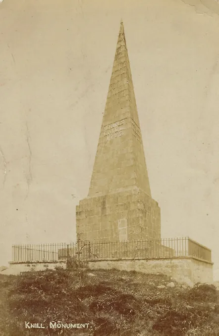

## Второстепенные персонажи

### Дату

*138 лет, загадочный слуга*

Дату — немой слуга ван Кортландта, который всюду сопровождает хозяина.

Во время службы в Голландской Ост-Индии ван Кортландт совершил поездку на Северную Суматру, где познакомился с племенем батаков, известным ритуальным людоедством. Из поездки он вернулся с молчаливым слугой по имени Дату («колдун» или «жрец» на языке батаков), который с тех пор не отходит от него.

- **Внешность:** атлетически сложенный, мускулистый, но довольно низкого роста. Голова обмотана икетом — традиционным тюрбаном батаков; одет в саронг. Глаза тёмные и свирепые, носит небольшие усы.
- **Черты:** никто никогда не слышал, чтобы он говорил. На любую попытку завязать разговор Дату отвечает свирепым взглядом.
- **Отыгрыш:** разбирается с каждым, кто подберётся к ван Кортландту слишком близко.

> ## Джон Нилл
>
> 
>
> Джон Нилл родился в 1783 году в Каллингтоне (Корнуолл). Он был сборщиком таможенных пошлин и мэром Сент-Айвса, но больше всего известен своим чудаковатым памятником — Шпилем Нилла. Этот гранитный обелиск высотой 15 м, возвышающийся над заливом Сент-Айвс, поначалу задумывался как место последнего упокоения останков Нилла. С одной стороны памятник украшен гербом Ниллов, а на трёх других высечены слова «Johannes Knill 1782», «Resurgam» («Я воскресну») и «I know that my Redeemer liveth» («Я знаю, что мой Искупитель жив»).
>
> Нилл оставил достаточно денег на содержание памятника после своей смерти, а в завещании распорядился тратить эти средства и на необычный поминальный обряд: каждые пять лет, в день святого Иакова, десять юных девушек должны шествовать от рыночного дома к памятнику, танцуя и распевая стихи 100-го псалма из Книги Псалмов.
>
> *Прим. перев.:* так в оригинале — «родился в 1783 году», хотя памятник с надписью «Johannes Knill 1782» построен в 1782 году (см. раздатку 10); исторический Джон Нилл родился в 1733 году — вероятно, опечатка.

### Геррит де Вит

*64 года, безумный рыбак*

Когда-то де Вит был добродушным рыбаком и жил в Слотене с женой и детьми. В декабре 1836 года, когда он возвращался к берегу, разразился сильный шторм; гик его лодки перекинуло ветром, и он ударил де Вита по голове. После этой травмы де Вит стал склонен к вспышкам ярости и приступам бреда и вскоре из-за них потерял и семью, и дом.

Однажды, обшаривая берега озера, де Вит нашёл карту Харлеммермера XVI века, на которой было отмечено место, где затонул испанский корабль, — по слухам, гружённый сокровищами. Наконец, после десяти лет поисков, де Вит отыскал обломки посреди озера, скрытые под вечным туманом, который, казалось, всегда окутывал там поверхность воды, и тут же принялся драгировать дно в поисках сокровищ — прямо над спящим ллойгором. Вскоре после того, как в апреле 1849 года заработала станция Линден, существо подчиняет себе де Вита и заставляет его вывести станцию из строя.

- **Внешность:** одет в гниющие старые лохмотья. У де Вита грязная зеленоватая борода и свирепые глаза, блестящие из-под кустистых бровей. Из левой подмышки у него растёт щупальце — подарок жестокого ллойгора.
- **Черты:** полудикий и совершенно безумный. Де Вит постоянно бормочет себе под нос; слышно, как он жалуется на шум со станции Линден всякий раз, когда та работает.
- **Отыгрыш:** виновник диверсии на станции Линден. Если де Вита поймают, он может сбежать и попытаться снова остановить станцию. Разобравшись в бессвязных речах де Вита, сыщики могут выйти на след ллойгора.

### Корнелис Саломонс

*44 года, пастор в Кааге*

Преподобный Корнелис Саломонс уже двадцать лет служит пастором реформатской церкви в Кааге. Вскоре после его приезда в деревню его жена Франсье забеременела, но из-за осложнений при родах мать умерла, а ребёнок — девочка по имени Юлия — остался слабоумным. Саломонс счёл смерть жены Божьей карой, и с тех пор его проповеди посвящены главным образом греху и покаянию.

С годами отношения между Корнелисом и Юлией так и не наладились. Узнав о её связи со Стробосом, пастор запер Юлию дома и запретил ей выходить. Вскоре после этого она тайком выбралась из дома, отправилась на паровую станцию Лехватер и напала там на инженера. Саломонсу удалось благодаря своему влиянию и положению в общине замять дело; позже он заявил, что у дочери нервный срыв и она поправляется на попечении дяди в Гронингене.

Однако пастор и не думал никуда отсылать дочь. Обнаружив на её теле странные уродства, он уверился, что Юлия одержима, и запер её в подвале дома. Слишком стыдясь, чтобы звать врачей, он сам удалил ей щупальца.
