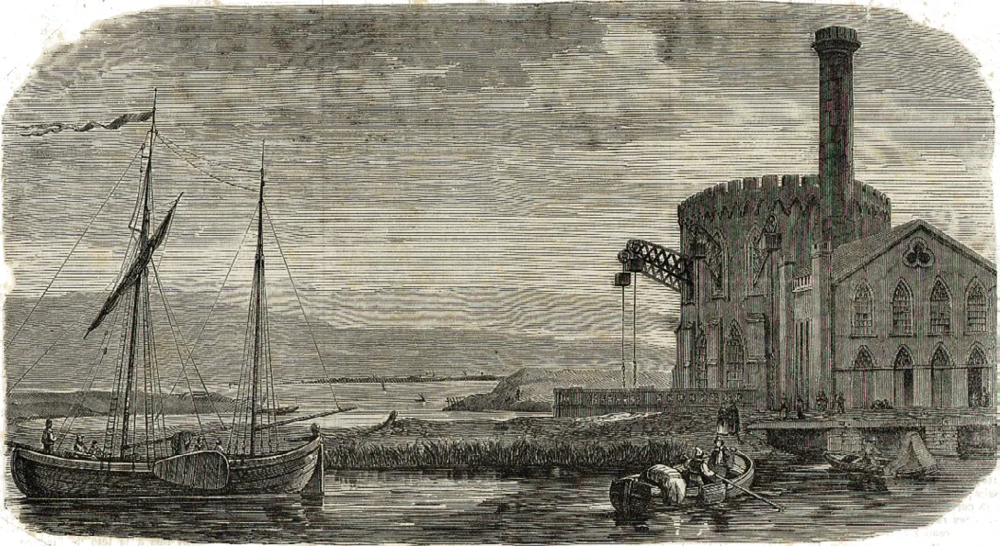

# Линден

Около полудня сыщики прибывают на насосную станцию Линден. Поездка в карете из Амстердама через Слотен заняла примерно полчаса. На горизонте виднеются Амстердам и Харлем, неподалёку — маленькая гавань Слотена. Кольцевой канал тянется с востока на запад, а на просторных водах раскинувшегося Харлеммермера трудятся рыбаки.

Станция Линден стоит у канала, посреди широкой, плоской, болотистой равнины, типичной для Нидерландов. Неоготическое здание из красного кирпича и белого песчаника состоит из круглого машинного зала и прямоугольной котельной. Круглую башню подпирают десять контрфорсов — они нужны, чтобы выдерживать срезающие усилия паровой машины внутри. Между контрфорсами и над ними видны готические окна. Зубцы придают башне слегка средневековый вид, который нарушают восемь чугунных балансиров: они торчат из верхних окон и соединяют машину с всасывающими насосами. Котельная тоже увенчана зубцами и прорезана несколькими готическими окнами. Между башней и котельной стоит дымовая труба высотой 25 м.

Рычаги станции неподвижны, а из трубы поднимается лишь тонкая струйка дыма. Сыщикам, прошедшим проверку **ОБР**, это покажется странным: Линден должен работать — его запустили в начале этого месяца.

У угольного сарая рядом со станцией ждёт прибытия сыщиков слуга. По его виду можно предположить, что он родом из Голландской Ост-Индии: голова обмотана тюрбаном, на бёдрах — тёмно-красный кусок ткани. Он не говорит ни слова, даже когда к нему обращаются, но поднимает руку, показывая, что сыщикам надо подождать, пока соберутся все. Когда вся группа на месте, Дату ведёт сыщиков в башню.

Когда сыщики входят, попросите пройти проверку **Внимания**. Прошедшие её замечают, что входная дверь повреждена — вероятно, её взломали.

## Насосная станция Линден

В круглой башне станции стоит крупнейшая в мире паровая машина. Главный цилиндр — 3,66 м в диаметре; он соединён с восемью штоками поршней, а те — с восемью массивными рычагами, которые выходят наружу через окна. Узкая чугунная винтовая лестница ведёт наверх, на площадку.

Когда сыщики входят, их окутывает тёплый пар. Похоже, он идёт из нескольких пробитых медных труб: вырываясь из трубопровода, пар шипит. Вдоль труб видно несколько ровных разрезов — значит, работали острым клинком. Успешная проверка **Механики** покажет, что, хотя повреждения и выглядят катастрофическими, их можно исправить за несколько часов.

В машинном зале десять человек, большинство из них занято ремонтом. Слуга подводит сыщиков к двум господам, беседующим у центрального цилиндра. Обоим на вид около 50 лет. У одного седеющие бакенбарды, он в костюме-тройке. Сыщики из высшего класса и те, кто пройдёт проверку **ОБР**, узнают в этом строгом господине йонкхера Геверса ван Эндегеста, политика-консерватора, который и просил их о помощи. Другой — темноволосый, с усами, в модном фраке и с белым шёлковым шарфом на шее — Виллем ван Кортландт, главный инженер и руководитель работ по осушению.

### Встреча с заказчиком

Все знакомятся. Йонкхер возмущён диверсией — по его мнению, это явно дело рук какого-то сумасшедшего. Он рад, что сыщики пришли, и надеется, что они найдут виновного. Геверс ван Эндегест считает, что преступника вернее всего искать среди рыбаков Слотена, которые прежде яростно и громогласно противились постройке станции.
