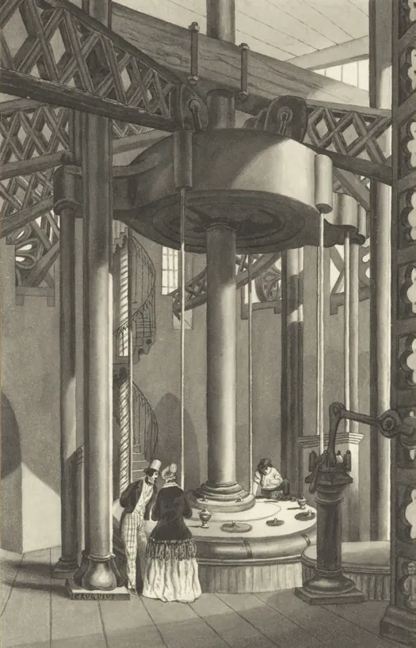

Затем йонкхер сообщает сыщикам, что времени на поиски виновного у них немного. Через несколько дней запустят станцию Круквиус — последнюю из трёх насосных станций. Поскольку в списке почётных гостей торжественного открытия значится королевская чета, к этому времени дело нужно уладить.

Потом йонкхер передаёт слово ван Кортландту, и тот объясняет, что в здание вломились около трёх часов прошлой ночью. Ночью на станции работает дежурная смена, и, когда выбили дверь, все они как раз были в котельной. Ван Кортландт указывает на подозрительного темноволосого человека, который сосредоточенно надевает медную муфту на шипящую трубу, называет его Эдвардом Ниллом, английским инженером, которого прислала компания, изготовившая паровые машины, и говорит, что именно он заметил внезапное падение давления в машине. Нилл якобы обнаружил диверсию, когда пошёл проверить машинный зал. Ремонт начали сразу же, но всерьёз взялись за него только на рассвете, когда пришла дневная смена.

Если сыщики пройдут проверку **Психологии**, они заметят, что ван Кортландт недолюбливает Нилла. Если надавить на него (нужна успешная проверка **Обаяния** или **Убеждения**), ван Кортландт скажет, что находит весьма любопытным, что диверсию обнаружил именно Нилл, и добавит, что «Харви и Ко», нанимателей Нилла, привлекли к осушению только на время. Последние полгода англичане обучали нидерландских рабочих, чтобы те со временем сами взяли на себя работу и обслуживание станций. Но такие неудачи затягивают передачу дел и приносят корнуоллской компании лишнюю прибыль.

Каковы бы ни были его личные мнения, твёрдых доказательств причастности Нилла у ван Кортландта нет. И всё же диверсия напоминает ему похожий, хотя и куда более серьёзный случай в прошлом году, когда на рабочего станции Лехватер напала девушка из соседней деревни (см. «Насосная станция Линден», с. 10). Сам ван Кортландт подробностей нападения не помнит, но намекает, что рабочие Лехватера должны знать больше.

### Таинственный знак

Когда сыщики стоят у цилиндра машины, попросите пройти **трудную** проверку **Внимания**. В случае успеха их взгляд привлекает маленький знак на заводской табличке, приклёпанной к поршню машины (наклонённый 綿, см. иллюстрацию рядом и раздатку 3 «Знак Линдена», с. 36). Он около 1 см в поперечнике и почти незаметен среди других букв на табличке. Любая попытка снять табличку привлечёт внимание рабочих станции. Если сыщики хотят разобраться в знаке, см. врезку на с. 12.

Когда сыщики спрашивают о знаке, и ван Кортландт, и йонкхер выглядят удивлёнными. Ван Кортландт скажет также, что таблички изначально ставили англичане. Сыщики, прошедшие **трудную** проверку **Психологии**, замечают, что ван Кортландт что-то недоговаривает.

**Примечание для Хранителя:** ван Кортландт лжёт — он заменил подлинные таблички «Харви и Ко» копиями, на которых между буквами вытравлен знак. Доказательства подмены можно найти в архиве конторы (см. «Контора», с. 22).

*Прим. перев.:* ссылка «см. „Насосная станция Линден“, с. 10» — так в оригинале; о нападении на Лехватере подробнее — в описании Юлии Саломонс (с. 7) и в главе «Лехватер» (с. 16).

### Корнуоллец

Эдвард Нилл подтвердит рассказ ван Кортландта о событиях прошлой ночи: он работал в котельной, когда давление в машине вдруг упало. Однако, когда он добрался до машинного зала, дело было уже сделано. При пробитых трубах тайком такую диверсию не устроить, но шум машины заглушает все прочие звуки, так что толком никто ничего не слышал.

Ниллу кажется, что, входя в дверь машинного зала, он видел, как от станции убегал один из местных рыбаков — Геррит де Вит. Де Вит уже дважды жаловался на шум машины, и во второй раз жалоба переросла в драку с самим Ниллом. Инженер настаивает, что машины не настолько громкие, чтобы не давать местным спать, и подозревает, что рыбак пытался уничтожить машину из-за денег. Де Вит живёт на окраине Слотена — рыбацкой деревни неподалёку.

Нилл сделает вид, что раньше никогда не видел знака на заводской табличке. Сыщики могут пройти проверку **Психологии** — при **трудном** успехе они поймут, что Нилл говорит не всю правду.

**Примечание для Хранителя:** на самом деле Нилл замечал знак и раньше и точно знает, что на подлинной табличке его не было. Он работает над переводом у себя в комнате (см. «Комната Нилла», с. 25).

### Меч над головой

Когда сыщики уже собираются уйти из машинного зала, попросите пройти проверку **Слуха**. В случае успеха они услышат металлический лязг — что-то металлическое ударилось о площадку прямо перед ними. Один из сыщиков (выберите случайно) должен пройти проверку **Уклонения**, чтобы отскочить в сторону. Если уклониться не удалось — 1d6 урона.

Металлический предмет — старый ржавый меч (считать средним мечом). Успешная проверка **Археологии**, **Оценки** или **Истории** покажет, что это вещь XVI века. Лезвие острое и блестит — значит, им недавно пользовались. При необходимости попросите пройти проверку **Идеи**, чтобы понять, что
