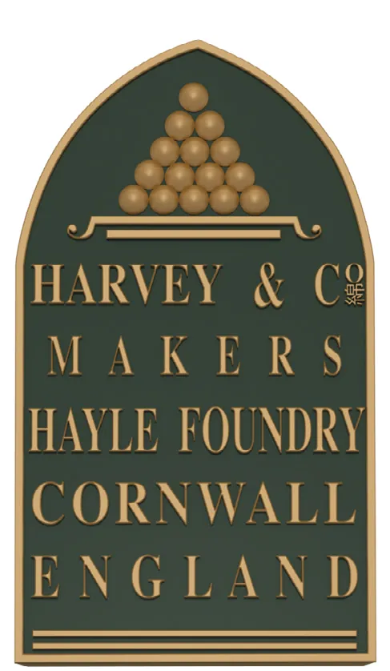
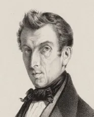

> ## Изучение знаков
>
> Если сыщики обнаружили таинственный знак на заводской табличке цилиндра, они могут пройти проверку **ОБР**. При **трудном** успехе сыщик поймёт, что это один из «восточных языков». **Чрезвычайный** успех позволит понять, что это японский, но не расшифровать знак.
>
> Если сыщики попытаются найти переводчика для знаков, выбор у них будет невелик: в Европе того времени азиатские языки знали очень немногие. Лучше всего снять с таблички оттиск и отнести его в Атенеум Иллюстре (букв. «Славная школа» — предшественник Амстердамского университета), чтобы найти там того, кто его переведёт. Если у сыщиков есть знакомые в университете, им будет нетрудно устроить встречу с профессором Тако Роордой, богословом и востоковедом, который вполне способен истолковать знак; если нет, чтобы найти его, нужно пройти проверку **Обаяния**, **Средств**, **Красноречия** или **Убеждения**.
>
> 
>
> ### Профессор Роорда
>
> 
>
> Когда сыщики к нему обратятся, профессор Роорда объяснит, что знаки — это кандзи: изначально китайские иероглифы, позже приспособленные для японского письма. Он охотно переведёт каждый иероглиф, с которого у сыщиков есть оттиск:
>
> | Станция | Знак | Чтение | Перевод |
> |---|---|---|---|
> | Линден | 綿 | вата | хлопок |
> | Лехватер | 見 | ми | видеть |
> | Круквиус | 津 | цу | гавань |
>
> По отдельности иероглифы ничего не говорят востоковеду, но он упомянет, что, если читать их фонетически, три иероглифа могут составлять одно слово. Расставить их можно шестью способами, и профессору понадобится время, чтобы выяснить, какой из них есть в словаре.
>
> Через несколько часов профессор Роорда сообщит сыщикам (через посыльного или лично), что если расположить иероглифы в порядке 綿津見 (хлопок, гавань, видеть), то они образуют японское слово «Вата-цу-ми», что значит «бог моря». Затем он объяснит, что в японском фольклоре было много разных драконов и у каждого — свои особые черты или отличительные признаки. Ватацуми, или морские драконы, будто бы черпают силу из воды, в которой живут, и умеют управлять дождями. Подробнее о японских драконах — в «Secrets of Japan», с. 230.
>
> ### Словарь
>
> Вместо того чтобы полагаться на знания профессора Роорды, сыщики могут заглянуть в японский словарь. В то время подданным Японии запрещалось учить японскому языку иностранцев, так что словари были редкостью. К счастью для сыщиков, в собрании университетской библиотеки такой словарь был.
>
> Но если сыщики спросят словарь у библиотекаря, окажется, что его куда-то не туда поставили и сейчас его нет. Если сыщики решат поискать в картотеке, пройдя проверку **Работы в библиотеке**, или убедят библиотекаря в своих добрых намерениях проверкой общения (**Обаяние**, **Средства**, **Красноречие**, **Запугивание** или **Убеждение**), они узнают, что последним словарь брал Эдвард Нилл и он до сих пор у него в комнате (см. «Комната Нилла», с. 25).
