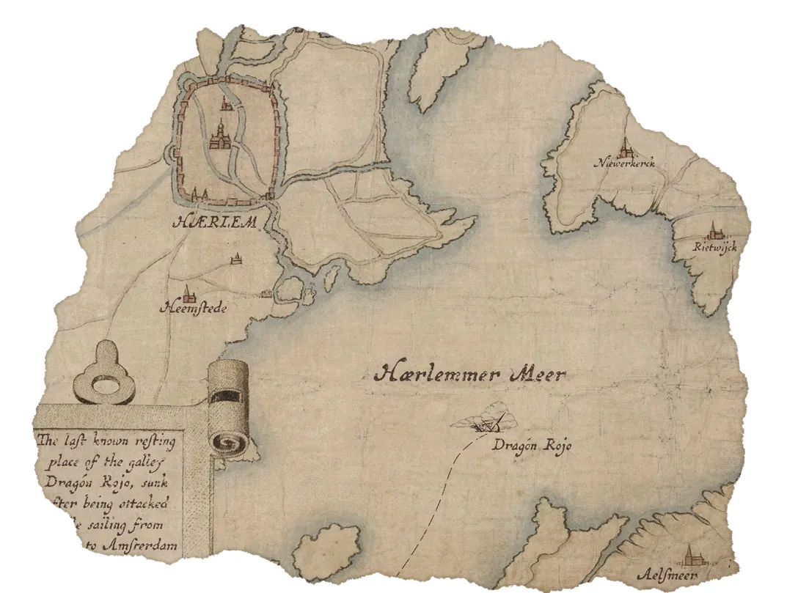

меч, скорее всего, и использовали, чтобы перерезать трубы. Как он оказался на площадке и почему упал, неясно. Наверху никого нет, а единственный путь оттуда ведёт через машинный зал.

Меч привлечёт внимание всех, кто есть в зале, особенно если кто-то ранен. Нилл расскажет сыщикам, что подобные странные случаи бывали и раньше: на всех трёх станциях то и дело пропадают снаряжение и инструменты или вдруг падают на ничего не подозревающих прохожих. Рабочие даже шутят между собой, что станции прокляты.

**Примечание для Хранителя:** меч — с обломков «Драгон Рохо» (см. «Расследование о „Драгон Рохо“», с. 14); им Геррит де Вит и повредил паровую станцию. Меч уронил на сыщиков ллойгор, пустив в ход свои телекинетические способности.

# Поиски Геррита де Вита

Геррит де Вит, рыбак, устроивший диверсию, живёт на окраине соседней деревни Слотен. С помощью местного полицейского Класа ван дер Хама (он есть среди готовых сыщиков, см. с. 41) сыщики без труда найдут жилище рыбака. После недавней вспышки буйства де Вита на станции Линден полицейский уже дважды туда наведывался, но ни разу никого не застал. Ван дер Хам подозревает, что де Вит проводит почти всё время где-то на озере, но не знает где (а выяснять слишком боится воды). Рыбак известен своей буйностью.

Другие жители Слотена могут рассказать о де Вите то же самое, но они не так охотно идут на разговор: чтобы что-нибудь из них вытянуть, сыщикам нужно пройти проверку общения (**Обаяние**, **Средства**, **Красноречие**, **Запугивание** или **Убеждение**). Если жители узнают, что сыщики связаны с осушением, они станут ещё менее сговорчивыми — ведь они кормятся озером (штрафная кость на все проверки общения).

### В лачуге де Вита

Когда сыщики подходят к жилищу Геррита де Вита, воздух становится затхлым и смрадным, а вокруг их голов начинают жужжать большие зелёные мухи. В лёгкой дымке, висящей над душной равниной, подстриженные ивы похожи на чёрных чудовищ со щупальцами. Наконец из тумана проступает зелёно-бурая лачуга, укрытая между двумя деревьями. Крышей служит старая перевёрнутая гребная лодка, которую подпирают мачта и два дерева, а стенами — большие куски плавника. Вход завешен небольшим куском паруса, двор перед лачугой завален дряхлыми рыбацкими вершами и истрёпанными сетями.

Внутри запах становится ещё хуже: каждый, кто входит, должен пройти проверку **ВЫН**. Прошедшие пробираются сквозь тучи жирных зелёных мух, которые взлетают, стоит отодвинуть парус; при провале сыщика тошнит.

Внутри лачуги полный беспорядок. Пол завален плавником и гниющими водорослями. Повсюду сырая рыба — частью объеденная, частью ещё целая. Если сыщики пройдут проверку **Внимания**, они заметят, что-то блестит между плавником и рыбьими костями. Присмотревшись, они поймут, что под мусором лежит меч, похожий на тот, с которым они столкнулись на станции Линден (см. «Меч над головой», с. 11).

На одном из кусков плавника на полу красно-бурым цветом нарисована змееподобная фигура. Сыщики, прошедшие проверку **Внимания**, заметят, что рисунок сделан кровью, а в дереве застрял ноготь, — это требует проверки **Рассудка** (0/1).

