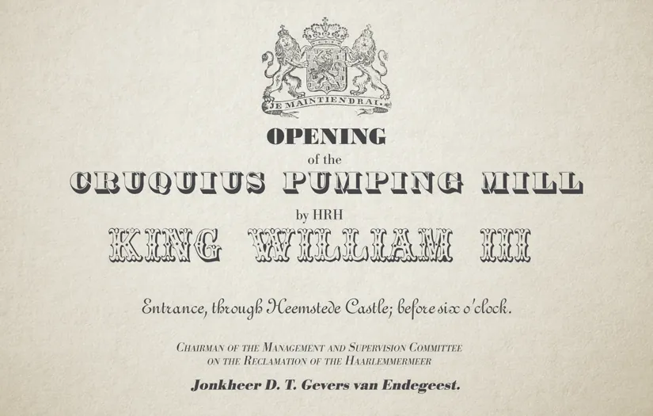

> ## Водяная камера Распхёйса
>
> Тюрьма Распхёйс («Тёрочный дом»), построенная в XVI веке, получила своё название по чёрной работе, которую выполняли её заключённые: они тёрли на тёрках бразильское дерево, получая красный краситель. Ходят слухи, что в нижних ярусах Распхёйса есть водяная камера — Ватерхёйс («Водяной дом»), одиночка для заключённых, которые отказываются работать. Говорят, стоит открыть шлюз, и Ватерхёйс заполняется водой из соседнего канала, так что заключённому приходится без остановки качать воду маленьким насосом, чтобы не утонуть. Если де Вита посадят в Распхёйс, он окажется строптивым заключённым и в конце концов попадёт в водяную камеру. Но в одиночке с де Витом свяжется ллойгор — ведь каналы Амстердама соединены с Харлеммермером…
>
> Для дополнительной сцены Хранитель может решить, что де Вит сбегает через день-два после того, как его против воли поместили в Распхёйс, лечебницу или подобное заведение для душевнобольных. Получив через посыльного весть о побеге, сыщики отправляются в это заведение и, осмотрев камеру, понимают, что дверь выломана изнутри, — для этого нужна огромная сила. От служителей сыщики узнают, что по пути де Вит напал на трёх санитаров, пытавшихся его остановить.
>
> Что де Вит станет делать после побега, решает Хранитель. Он может ещё раз попытаться вывести из строя станцию Линден — на этот раз пытаясь заклинить огромный поршень, который в итоге раздавит его. Или может прятаться до конца сценария, а потом объявиться, чтобы помешать ван Кортландту завершить ритуал (см. «Речь ван Кортландта», с. 29).

# Итоги

Когда с де Витом покончено, сыщики получают записку: йонкхер Геверс ван Эндегест ждёт их в своём особняке, замке Хемстеде, чтобы они доложили, как продвигается расследование. Двухэтажная усадьба стоит примерно в 100 м к западу от станции Круквиус (см. «Насосная станция Круквиус», с. 22), на другом берегу Кольцевого канала. Её богато украшенный фасад стоит в конце длинной ухоженной подъездной аллеи.

Сыщиков встречают слуги йонкхера и ведут длинным коридором, увешанным портретами суровых предков ван Эндегеста, в великолепную библиотеку, где йонкхер читает. Он предлагает им сесть и спрашивает, как продвигается дело.

Выслушав доклад, йонкхер выражает удовлетворение арестом диверсанта и упоминает, что похожий случай произошёл в прошлом году на станции Лехватер. Йонкхер признаётся, что помнит тот случай смутно, и советует расспросить о нём работников станции — так сыщики переходят к следующей части сценария.

В знак благодарности йонкхер приглашает сыщиков на торжественное открытие станции Круквиус (см. раздатку 5 «Приглашение на открытие Круквиуса», с. 37). Среди почётных гостей будет недавно коронованный король Виллем III, чей дед начал осушение. Дату в приглашении Хранитель может назначить по своему усмотрению, но рекомендуется дать сыщикам хотя бы два дня, чтобы выяснить, что произошло на станции Лехватер (см. «Открытие станции Круквиус», с. 28).

### Крик наверху

Когда встреча с Геверсом ван Эндегестом закончена и гостей йонкхера провожают к парадной двери, попросите пройти проверку **Слуха**. В случае успеха сыщики услышат, как наверху кричит женщина. Камердинер не обращает на крик внимания и идёт дальше к двери.

Сыщики, которые побегут наверх посмотреть, в чём дело, найдут в постели йонквроу Дёйц ван Асенделфт: она, по-видимому, только что проснулась и вся в поту. Она признаётся, что ей приснился страшный сон, и зовёт мужа.

Йонквроу неохотно рассказывает о своём кошмаре, но сделает исключение для знакомого (например, готового сыщика Хендрика Бома) или для того, кто пройдёт проверку **Обаяния** или **Убеждения**. Таким сыщикам она расскажет, что во сне спокойно плавала, как вдруг большая змея утащила её под воду. Хотя она изо всех сил пыталась отбиться от змея, борьба оказалась тщетной, и в конце концов существо её поглотило.

Вскоре в комнату входит йонкхер. Услышав о кошмарах жены, он советует ей прокатиться на лодке, чтобы успокоить нервы. Затем сыщиков просят уйти; они могут решить заглянуть в другие места поблизости (см. «Круквиус», с. 22).
