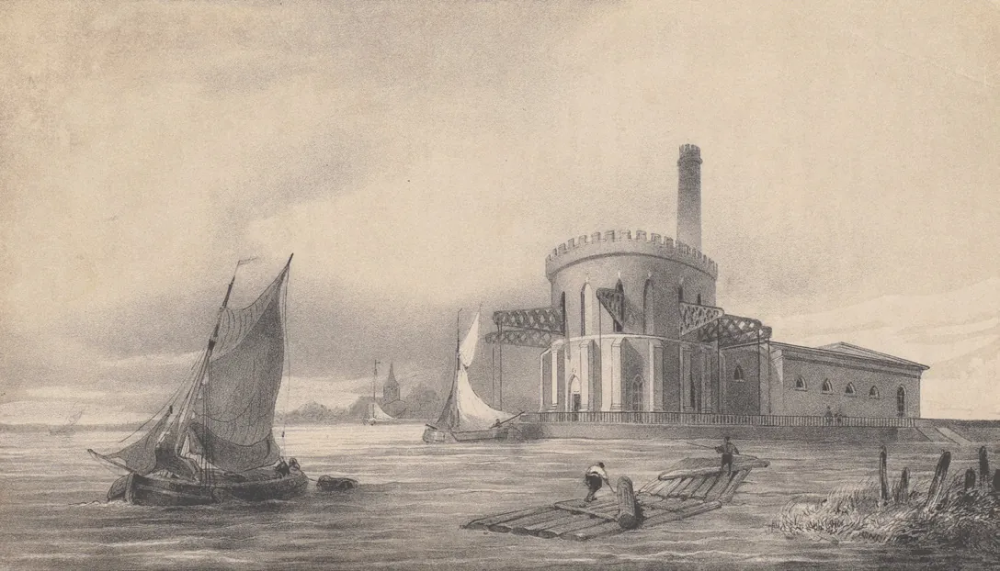

# Лехватер

Главная причина, по которой сыщики едут на Лехватер, — случай, о котором упоминали и йонкхер, и ван Кортландт и который произошёл там в прошлом году. Ещё один повод — проверить, нет ли японского знака и на поршне машины Лехватера.

Лехватер стоит на юго-западе Харлеммермера, у Кагер-Гата (протоки у Каага), который недавно перекрыл Кольцевой канал. Быстрее всего добраться туда так: полтора часа поездом из Амстердама в Лейден, а потом три часа на плоскодонке через польдеры. Можно добраться и иначе (в карете, под парусом через озеро или даже на трекскёйте — барже на конной тяге), но это займёт больше времени.

Вдали видна мрачная деревня Кааг; высокий церковный шпиль поднимается намного выше соседних домов.

## Насосная станция Лехватер

Из трёх насосных станций, задуманных для осушения Харлеммермера, Лехватер поставили первым. Строительство началось в июле 1843 года и закончилось к сентябрю 1845 года. Уроки, извлечённые при постройке, сразу же учли, внеся небольшие изменения в проекты остальных станций. Когда все первоначальные неполадки и сбои были устранены, Лехватер почти год назад, 7 июня 1848 года, запустили на полную мощность.

Лехватер похож на две другие насосные станции; единственное существенное различие в устройстве — число насосных рычагов: у Лехватера их одиннадцать, а у двух других станций — по восемь. Официально перемену объяснили тем, что восьми рычагов с лихвой хватает для нужной мощности осушения.

Когда сыщики прибывают на станцию, она работает в обычном режиме. Сыщики, прошедшие проверку **ИНТ**, заметят, что насосы Лехватера работают с частотой около 16 циклов в минуту — гораздо медленнее, чем и на Линдене, и на Круквиусе.

*Прим. перев.:* «около 16 циклов в минуту» — так в оригинале; по другим местам книги (с. 26, 37, 40) частота Лехватера — 8 циклов в минуту (16 — у Линдена), и только так она «гораздо медленнее».

**Примечание для Хранителя:** на самом деле и одиннадцать рычагов Лехватера, и его более медленная работа — дело рук ван Кортландта: и то и другое нужно для ритуала, которым инженер собирается разбудить ллойгора (см. «Контора», с. 22).

Внутри сыщики застают смену из десяти рабочих станции (характеристики — см. «Рабочий паровой насосной станции», с. 32). Половина из них кочегарит в котельной, остальные следят за машиной.

Когда сыщики спрашивают о прошлогоднем случае, рабочие неохотно идут на разговор и, ссылаясь на занятость, уклоняются от дальнейших расспросов. Если сыщики пройдут проверку **Обаяния**, **Красноречия**, **Запугивания** или **Убеждения**, работники станут разговорчивее: в августе прошлого года дочь местного проповедника напала на старшего инженера-механика по имени Ян Вервер. В последовавшей потасовке у станции Вервер неудачно упал, ударился головой и вскоре умер. После этого случая Эдварда Нилла повысили до должности Вервера, и он принял его обязанности.

### Второй знак

На заводской табличке поршня машины тоже есть знак, похожий на те, что сыщики нашли на других станциях: наклонённый 見 (по-японски «видеть», см. раздатку 6 «Знак Лехватера», с. 36). Если сыщики знают о знаке, они без труда его найдут. Иначе его можно заметить при **трудной** проверке **Внимания**. Если сыщики хотят разобраться в знаке, см. «Изучение знаков», с. 12.
