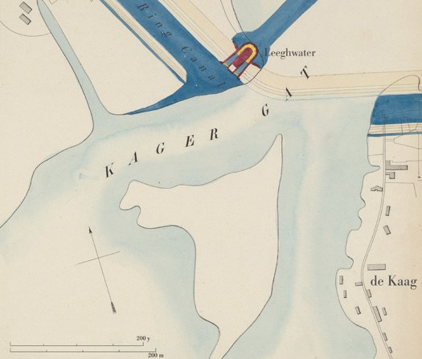
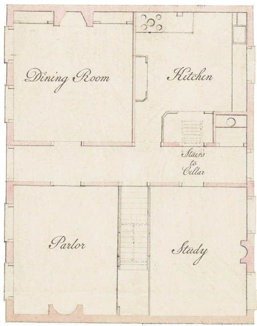

*Подписи на карте:* Leeghwater — Лехватер; KAGER GAT — Кагер-Гат; de Kaag — Кааг; синим — Кольцевой канал.

# Кааг

Поговорив с рабочими Лехватера, сыщики могут отправиться в Кааг, чтобы побольше узнать о дочери пастора — той самой, что в прошлом году напала на инженера-механика.

Кааг — крошечная деревня на Кагерэйланде (острове Кааг), клочке земли, куда можно попасть только на лодке: мостов на большую землю нет. Как и жители Слотена, жители Каага не слишком жалуют чужаков из города, особенно тех, кто служит той самой организации, что хочет лишить их средств к жизни. К тому же большинство из них — глубоко верующие христиане, которые ни за что не стали бы критиковать своего любимого пастора. Ко всем проверкам общения с жителями деревни добавляется штрафная кость.

Когда сыщики прибывают в Кааг, с озера дует сильный ветер, а в лицо не переставая хлещет морось. Из примечательных мест на острове — небольшой сухой док и пристань рядом с ним, деревенская лавка, трактир, маленький полицейский пост и высокая деревенская церковь с пасторским домом неподалёку. Если только сейчас не раннее утро или не поздний вечер, сыщики, скорее всего, застанут деревню почти безлюдной: большинство жителей рыбачит на Харлеммермере.

## Церковь и пасторский дом

Над деревней возвышается однонефная церковь XVI века с большой колокольней. Успешная проверка **Внимания** покажет, что здание обветшало: крыша, похоже, протекает. Табличка на двери гласит, что церковь принадлежит местному приходу Нидерландской реформатской церкви и что каждое утро в половине шестого здесь проходит короткая служба. Более долгая служба — по воскресеньям в девять.

Рядом с деревенской церковью стоит маленький пасторский дом — жилище преподобного Корнелиса Саломонса. Пастор проводит там почти всё время, отлучаясь лишь на церковные службы и изредка — навестить кого-нибудь из пожилых прихожан.

Дверь открывает строгий худой человек с запавшими глазами, который представляется пастором Саломонсом. Он пригласит сыщиков в дом, если те назовут убедительную причину визита. Полицейских, священников и прочих облечённых властью примут без вопросов; остальным нужна успешная проверка **Убеждения** (к проверкам **Запугивания** и **Обаяния** добавляется штрафная кость: на пастора не действует ни то ни другое).

В пасторском доме четыре главные комнаты. Сыщиков проводят мимо столовой и гостиной в кабинет. Саломонс садится за стол из тёмного дуба, на котором лежит явно зачитанная Библия. Он предлагает сыщикам сесть на один из неудобных стульев. У стены — два больших книжных шкафа, уставленных Библиями и всевозможными богословскими трудами. За спиной пастора виден маленький камин, но огня в нём нет.

### Разговор с Саломонсом

Когда его спрашивают о дочери или о событиях прошлого лета, пастор на миг умолкает. Рассказывая, он хмурится: в августе прошлого года он запер дочь Юлию дома, чтобы наказать за «нехристианское» поведение. Через несколько недель ей как-то удалось сбежать, она добралась до станции Лехватер и там напала на инженера Вервера. В потасовке тот ударился головой и позже умер от травмы. С тех пор пастор поминает Вервера и его семью в молитвах.

Саломонс объясняет, что дочь всегда страдала душевным расстройством, но никогда прежде не была агрессивной. Врач из Лейденского университета, к которому они ездили, не нашёл у неё ничего дурного, но заметил, что Юлии пойдут на пользу покой и тишина сельской жизни. Поэтому пастор отправил её жить к своему брату Питеру, фермеру из маленькой деревни в северной провинции Гронинген, в нескольких днях пути от Амстердама (и далеко за самыми дальними краями телеграфной сети).

**Примечание для Хранителя:** на самом деле Саломонс не отправлял дочь к брату — у него даже нет ни братьев, ни сестёр. Вместо этого он запер Юлию в подвале пасторского дома.

Пастор не хочет объяснять, почему держал дочь взаперти, считая это личным делом. Если сыщики пройдут **трудную** проверку **Убеждения** (с бонусной костью для полицейских, священников, врачей и других облечённых властью) или **трудную** проверку **Запугивания** либо **Обаяния** со штрафной костью, он немного откроется.

С явным отвращением Саломонс скажет, что считает дочь грешницей. С самого рождения, когда она потеряла мать, её умственные способности казались несколько ограниченными по сравнению с другими детьми. Несмотря

*Подписи на плане:* Dining Room — столовая; Kitchen — кухня; Stairs to Cillar — лестница в подвал (*так в оригинале — «Cillar» вместо «Cellar»*); Parlor — гостиная; Study — кабинет.
