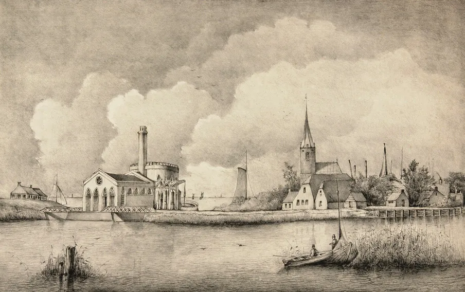

на религиозное воспитание — а может, как раз из-за своей недалёкости, — она, похоже, твёрдо решила вести, по его мнению, «безнравственную» жизнь. Прошлым летом она связалась с одним из молодых деревенских рыбаков, неким Флорентейном Стробосом. Когда пастор узнал, что Юлия и Стробос вместе выходят на озеро, он запретил ей видеться с рыбаком и запер её в доме.

Если сыщики добились **чрезвычайного** успеха в проверке общения, Саломонс не выдержит и признается, что его дочь заперта в подвале пасторского дома, а не уехала к брату, и сам поведёт их вниз (см. «В глубину» ниже).

Саломонс не знает, куда на озере плавала эта парочка, но знает, что от этих прогулок дочери стало только хуже. Она стала буйной и постоянно жаловалась на шум соседней станции Лехватер. Во всём, что с ней теперь творится, проповедник целиком винит Стробоса.

Если спросить, не происходили ли с Юлией телесные изменения (то есть уродства), пастор запаникует, потом сделает вид, что оскорблён, и в конце концов попросит сыщиков уйти.

После разговора с Саломонсом попросите игроков пройти **трудную** проверку **Психологии**. В случае успеха они заметят, что он говорит не всю правду.

При успешной проверке **Внимания** сыщики заметят, что не все книги пастора посвящены религии. Между двумя богословскими томами засунут трактат о хирургии. Открыв его, сыщики увидят, что глава об ампутации покрыта чем-то похожим на засохшую кровь (проверка **Рассудка**, потеря 0/1).

Если, выходя из кабинета, сыщики пройдут проверку **Слуха**, они заметят, что их шаги по ковру в коридоре звучат иначе, — будто под половицами есть какая-то полость. Те, кто добился **трудного** успеха в проверке **Слуха**, отчётливо слышат глухой удар снизу.

### В глубину

Если сыщики попытаются выяснить, откуда шум, они заметят под ковром в главном коридоре пасторского дома люк. Он заперт на висячий замок, который может открыть Саломонс — ключ он носит при себе. Иначе дверцу легко взломать успешной проверкой **СИЛ**. Подойдёт и успешная проверка **Взлома**.

Под открытым люком — узкая деревянная лестница, уходящая вниз на 1,8 м. В подвале темно, но на кухне есть масляные лампы и свечи. Снизу сыщикам слышен лязг цепей и время от времени глухие удары. Чувствуется и мерзкий запах — смесь крови и гнили.

Внизу, в подвале, к деревянному столу железными цепями привязана Юлия Саломонс. В ней уже едва можно узнать человека: из обеих подмышек и из живота растут щупальца, а правая рука превратилась в клешню. Когда Юлия пытается заговорить, становится ясно, что язык у неё вырезан, и она может издавать лишь едва внятные звуки. Сыщики разбирают только слова «дракон», «громко» и «барабаны». Если осмотреть её внимательнее, на теле видны следы недавней операции: некоторые уродства, похоже, ампутированы, и кровавые остатки гниют на полу. Вид Юлии Саломонс требует проверки **Рассудка** (потеря 1d3+1/1d6+1).

*Прим. перев.:* так в оригинале — здесь потеря Рассудка 1d3+1/1d6+1, а в статблоке Юлии (с. 32) — 1d3/1d6; щупальца и клешня здесь описаны иначе, чем в описании Юлии на с. 7 (там щупальца — из живота и левой подмышки, клешня — «другая» рука).

Внезапно, без всякой причины, люк наверху с грохотом захлопывается, а порыв ветра гасит в подвале весь свет. Сыщикам придётся искать дорогу наверх в темноте, под отвлекающий лязг цепей и невнятные стоны.

Если сыщики окажутся настолько глупы, что освободят Юлию, она убежит и попытается вывести из строя Лехватер, нападая на всех, кто встанет у неё на пути. Или же сыщики могут попробовать найти лечебницу для душевнобольных или больницу, которая примет дочь пастора. Учитывая её странный облик, им придётся придумать объяснение её состоянию, прежде чем какое-нибудь заведение согласится её принять.

**Примечание для Хранителя:** люк захлопнул ллойгор. Как и в лачуге де Вита, существо дотянулось до пасторского дома своими телекинетическими силами, чтобы защитить свою рабыню от любопытных сыщиков.

