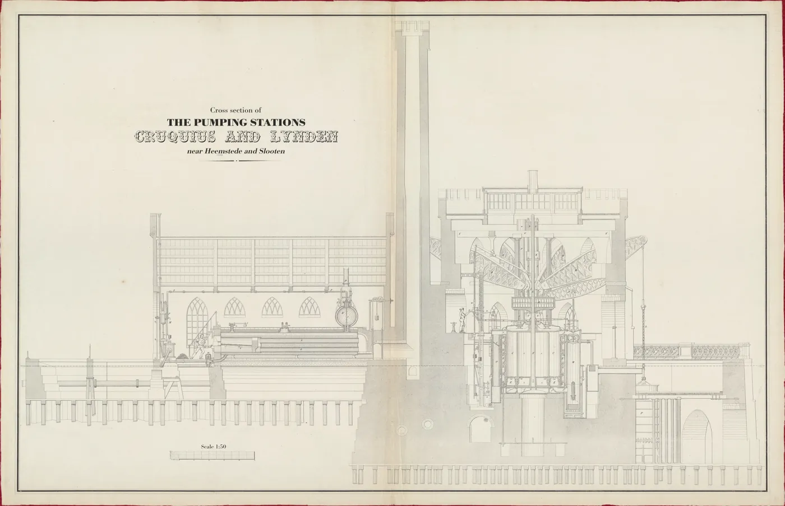

## Разрез насосных станций Круквиус и Линден близ Хемстеде и Слотена

*Подписи на чертеже:* «Cross section of the Pumping Stations Cruquius and Lynden near Heemstede and Slooten» — разрез насосных станций Круквиус и Линден близ Хемстеде и Слотена; Scale 1:50 — масштаб 1:50. Чертёж занимает разворот без номеров страниц; правая половина — на следующей странице.
