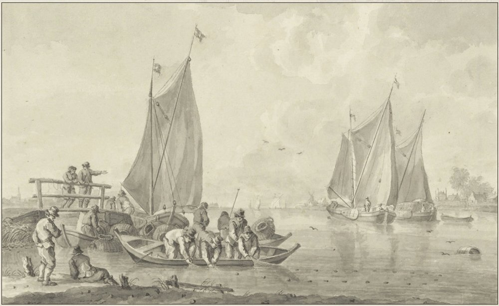

### Рыбак-возлюбленный

Совсем новый сухой док в деревне открыл в начале этого года Кристиан ван Лент — бывший рыбак, который сменил занятие, поскольку решил, что прокормиться рыбной ловлей скоро станет невозможно. Сейчас в доке строится маленькая яхта, а рядом в воду уходит пристань.

Как и все рыбаки, Стробос проводит большую часть дня на воде. Если сыщики хотят его расспросить, им придётся подождать до заката или самим выйти на озеро.

Флорентейн Стробос — молодой рыбак с добродушной улыбкой. Он расскажет сыщикам, что познакомился с Юлией Саломонс около года назад и вскоре они полюбили друг друга и часто вместе выходили на лодке на озеро. У Юлии было любимое место, укрытое в туманных банках, где ей было спокойнее всего и где они могли обниматься без помех. Но однажды в августе их заметил другой рыбак и рассказал её отцу об их тайных свиданиях. Разъярённый пастор запретил им видеться и посадил дочь под домашний арест. Стробос даже просил у него руки Юлии, но проповедник захлопнул дверь у него перед носом. Через несколько недель Стробос услышал, что Юлия напала на человека на станции Лехватер. Он хоть убей не может понять, зачем ей было это делать, — она никогда не была буйной. После случившегося Юлию якобы отправили к дяде на север, и с тех пор Флорентейн её не видел.

Если сыщики пройдут проверку общения (**Обаяние**, **Средства**, **Красноречие**, **Запугивание** или **Убеждение**), Стробос доверит им, что пастор никогда прежде не упоминал при жителях деревни ни о каком брате. Рыбак уверен, что пастор не отправлял её в Гронинген, а запер Юлию где-то в доме. Если сыщики решат её найти, он присоединится к ним.

## Другие места Каага

Большинство жителей Каага не жалуют чужаков, сующих нос в личные дела их любимого пастора. Чтобы поговорить с кем-нибудь из жителей, сыщикам нужно пройти проверку общения (**Обаяние**, **Средства**, **Запугивание** или **Убеждение**) со штрафной костью. В случае успеха жители подтвердят рассказ Флорентейна. При **чрезвычайном** успехе они признают, что никогда прежде не слышали, чтобы у Саломонса был брат.

### Лавка

Маленькая бакалейная лавка, где есть всё, что может понадобиться жителям деревни. Если сыщики пройдут проверку общения (со штрафной костью, см. выше), лавочник скажет, что пастор редко покупает у него съестное — должно быть, почти ничего не ест.

### Трактир

Деревенский трактир даёт приезжим кров, подаёт еду и напитки. Здесь сыщики могут узнать местные сплетни или даже заночевать, если задержатся и пропустят последний паром на большую землю.

Хозяин трактира Ари Велтстра приветлив и словоохотлив, так что для разговора с ним проверки навыков не нужны. Односельчане нечасто заглядывают к Велтстре: строгая вера запрещает им пить. Но с тех пор как построили станцию Лехватер, дела пошли лучше: рабочие станции после смены обычно спускают здесь свой заработок.

### Полицейский пост

Местный полицейский, фельдвахтер (сельский констебль) по имени Ринус Бринкхорст, арестовал Стробоса после его последней прогулки на лодке с Юлией Саломонс. Однако вскоре Бринкхорсту пришлось его отпустить: рыбак не совершил никакого преступления.

Через две недели Бринкхорста вызвали, когда Юлия напала на рабочего Лехватера. Скрутить её стоило огромных трудов: она обладала громадной, казалось бы, сверхъестественной силой. Комитет по осушению выплатил семье Яна Вервера, пострадавшего в потасовке на станции, возмещение, и та решила не подавать на Юлию в суд. Вскоре девушку отпустили на попечение пастора, который якобы отправил её к брату.

