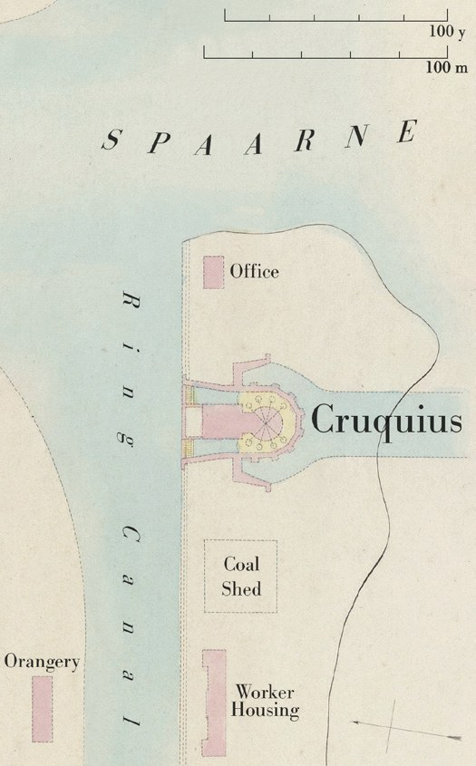

# Круквиус

У сыщиков может быть много причин наведаться в окрестности станции Круквиус: проверить, нет ли на поршне ещё одного таинственного знака, зайти в контору ван Кортландта, которая стоит рядом, или навестить Эдварда Нилла в его комнате в жилье рабочих. Привести сыщиков сюда может и йонкхер Геверс ван Эндегест — он живёт неподалёку.

Дорога от Амстердама до станции Круквиус занимает не меньше часа, половина из которого уходит на поезд из Амстердама в Харлем. Можно добраться и по каналу-трекварту, который идёт тем же путём, что и железная дорога, но это вчетверо дольше. От Харлема до станции ещё полчаса — в карете или на лодке вниз по реке Спарне.

Как и её сёстры, станция Круквиус высится над Харлеммермером и Кольцевым каналом. Река Спарне течёт прямо рядом со станцией, на соседнем пастбище пасутся коровы. К востоку от станции стоит простое здание конторы, к западу — угольный сарай и большое здание, где живут рабочие станции. У ближней пристани причалены две гребные лодки и тяжёлая баржа. На барже стоит кран, который сейчас держит на весу большую металлическую камеру. Сыщики, прошедшие проверку **ОБР**, узнают в этой камере водолазный колокол.

К северу, на другом берегу канала, раскинулось обширное поместье Геверса ван Эндегеста с модной Оранжереей. Сыщики приходят к нему, чтобы доложить о ходе расследования (см. «Итоги», с. 15), и ещё раз — на торжественное открытие станции Круквиус (см. «Открытие станции Круквиус», с. 28).

## Насосная станция Круквиус

Строительство станции Круквиус почти закончено, и работать она должна начать во время официальной церемонии открытия (на которую приглашены сыщики).

Насосная станция Круквиус — точный близнец Линдена (см. «Насосная станция Линден», с. 10). У неё восемь насосных рычагов. Полностью станцию ещё не запустили — сейчас идёт последняя серия испытаний перед пуском. Если сыщики пройдут проверку **ИНТ**, они заметят, что во время этих испытаний машина работает куда чаще, чем на станциях-сёстрах (24 цикла в минуту). Высокая частота явно сильно сказывается на здании: шестерни и балки скрипят от напряжения, со стен, похоже, сыплются пыль и мусор. Любой сыщик с навыком **Наука (инженерное дело)** знает, что паровая машина не может работать с такой частотой больше пары дней.

Обычно в здании станции Круквиус одновременно работают 10 человек (характеристики — см. «Рабочий паровой насосной станции», с. 32), заканчивающих отделку машины. При успешной проверке общения (**Обаяние**, **Красноречие**, **Запугивание** или **Убеждение**) они ответят на любые вопросы сыщиков. Если спросить о высокой частоте, они скажут, что машины настроены по последним указаниям господина ван Кортландта.

### Третий знак

Если сыщики осмотрят заводскую табличку на поршне или пройдут **трудную** проверку **Внимания**, они заметят наклонённый 津 (по-японски «гавань», см. раздатку 7 «Знак Круквиуса», с. 36), вытравленный на том же месте, что и на двух других станциях. Если сыщики хотят разобраться в знаке, см. «Изучение знаков», с. 12.

## Контора

Примерно в 50 м к востоку от насосной станции построили небольшое здание конторы. Это простой деревянный одноэтажный дом со входами с южной и с северной стороны. Ставни юго-западного окна закрыты даже днём.

В конторе располагается Виллем ван Кортландт, главный инженер осушения. Здание служит в основном для управления работами, но заодно и квартирой ван Кортландта, так что инженер бывает здесь и днём, и ночью. Ван Кортландт, которого всегда сопровождает слуга Дату, покидает контору, лишь когда его присутствие требуется в другом месте, например на одной из станций.

По ночам ван Кортландт часто выходит на озеро навестить ллойгора. Если сыщики решат за ним проследить, им нужно пройти проверку **Скрытности**, чтобы их не заметили. В случае успеха они увидят, как он произносит заклинание «Дыхание каппы» и медленно погружается в озеро. Вместо того чтобы вынырнуть за воздухом, он оставляет за собой цепочку пузырей, которая

*Подписи на карте:* SPAARNE — Спарне; Office — контора; Cruquius — Круквиус; Ring Canal — Кольцевой канал; Coal Shed — угольный сарай; Worker Housing — жильё рабочих; Orangery — Оранжерея; масштабная линейка — 100 ярдов (100 y) и 100 м.
