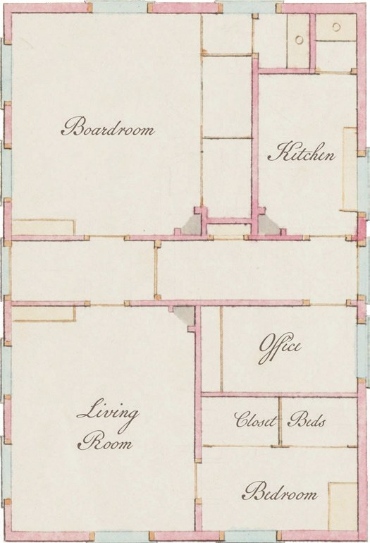

можно проследить, пройдя проверку **Чтения следов**. Если сыщикам удалось проследить за ван Кортландтом, см. «Два дракона», с. 27.

### Зал заседаний

Северный, главный вход ведёт в коридор с тремя дверями. На востоке — зал заседаний: посреди комнаты большой дубовый стол и шесть стульев. За двумя другими дверями — кровати-шкафы, которыми давно не пользовались.

### Гостиная

Западная дверь коридора ведёт в гостиную. Три удобных кресла стоят кругом, сбоку — маленький столик. На одной стене висит картина с видом Харлеммермера, другую украшает японская гравюра на дереве с морским пейзажем. Дверь в северной стене ведёт в спальню.

### Спальня

Дверь спальни всегда заперта; чтобы открыть её, нужна успешная проверка **Взлома** или **СИЛ**. Ключ ван Кортландт всегда носит при себе.

Шторы задёрнуты, ставни закрыты, так что даже днём в спальне темно. Первое, что видят сыщики, войдя в комнату, — ухмыляющийся рогатый демон; это требует проверки **Рассудка** (0/1d2). Когда глаза привыкают к темноте, они понимают, что «демон» — японская маска ханнья на вешалке у двери.

*Подписи на плане:* Boardroom — зал заседаний; Closet Beds — кровати-шкафы; Living Room — гостиная; Bedroom — спальня; Kitchen — кухня; Office — кабинет.

Вся комната заставлена японскими вещицами. Стены украшены гравюрами на дереве с драконами и другими сказочными существами. Рядом с картинами висят подробные карты Японии. Успешная проверка **ОБР** позволит узнать на одной из карт Дэдзиму — голландскую факторию в Японии.

На богато украшенной подставке лежит острая как бритва декоративная катана — если только ван Кортландт не взял её с собой (см. «Два дракона», с. 27).

Похоже, ван Кортландт не спит ни на одной из кроватей-шкафов спальни, а пользуется матрасом-футоном, расстеленным на полу. В кроватях-шкафах выставлены другие предметы его обширного собрания японских памятных вещей. Левая кровать заполнена барабанами от 30 см до 1,2 м в диаметре. В другой — деревянные статуэтки, в основном драконов. Отдельной постели для Дату, слуги ван Кортландта, в спальне, похоже, нигде нет.

В комнате пахнет сладкими благовониями; часть их тлеет на подставке у постели.

### Кухня

Южная дверь коридора ведёт в другой коридор с тремя дверями. Южная из них ведёт обратно на улицу. На востоке — маленькая кухня, которой, похоже, почти не пользуются.

### Кабинет

Западная дверь открывается в кабинет. Посреди комнаты — чистый письменный стол с единственным ящиком. Большой встроенный шкаф заполнен папками и делами, связанными с осушением. Чтобы пересмотреть все эти бумаги, понадобится пара часов; это позволяет сыщикам пройти три проверки **Работы в библиотеке**.

- При одном успехе они находят накладную на три новые заводские таблички, изготовленные кузнецом в Амстердаме и отправленные ван Кортландту. На приложенных к накладной эскизах табличек ясно видны японские иероглифы, которые сыщики нашли на насосных станциях.
- При двух успехах сыщики находят ещё и письмо директора «Харви и Ко» ван Кортландту, где тот замечает, что место, выбранное для станции Круквиус, не лучшее. Поскольку в Нидерландах преобладают западные ветры, разумнее было бы построить станцию на другом берегу озера, у Алсмера.
- При трёх успехах им удаётся найти и другое, более позднее письмо «Харви и Ко», где ван Кортландта предостерегают от частоты откачки, которую он рекомендовал для станций Линден и Круквиус. При таких скоростях, утверждается в письме, машины скоро выйдут из строя.

**Примечание для Хранителя:** и особое расположение станций, и частота их работы, и знаки на заводских табличках — всё это нужно для ритуала, который хочет провести ван Кортландт. См. ниже, а также «Речь ван Кортландта», с. 29.

В ящике стола сыщики могут найти прямоугольную деревянную шкатулку, покрытую искусной резьбой с мифическими фигурами, размером 15 см в ширину, 7,5 см в высоту и 7,5 см в глубину. Эта японская шкатулка-головоломка снабжена механизмом, который открывается лишь после целой последовательности действий с деталями шкатулки. В игровых терминах это значит, что сыщикам нужно пройти **трудную** проверку **ЛВК**. Или же они могут разломать шкатулку, пройдя проверку **СИЛ**. Внутри:

- пять старинных японских свитков. Хотя надписи сыщикам непонятны, рисунки жутких драконов вполне ясны (проверка **Рассудка**, 0/1d4). Это страницы, которые ван Кортландт вырвал из «Синва тайдзэн то дэнса но Ниппон» («Книги мифов и легенд Японии», см. «Secrets of Japan», с. 132).
