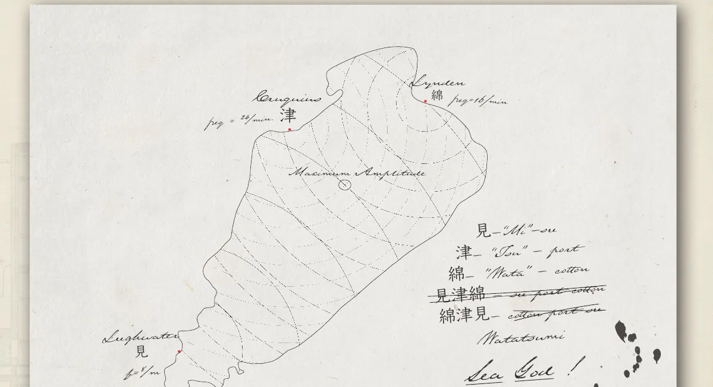

Если спросить о Джоне Нилле, Эдвард скажет, что почти не знал дядю: Джон умер за двенадцать лет до его рождения. Но отец Эдварда всегда тепло отзывался о брате, как и другие жители Сент-Айвса. По словам Эдварда, Джон Нилл хотел, чтобы обелиск стал его могилой — в знак протеста против переполненности кладбищ, землю на которых раз за разом поднимали, чтобы освободить место для новых погребений. По злой иронии судьбы Джон умер в Лондоне и был там похоронен, так что обелиск так и не послужил своему изначальному назначению. Шествие, которое раз в пять лет устраивают в память о дяде, Эдвард считает всего лишь безобидной традицией христианского толка, которая после смерти Джона стала изрядной приманкой для приезжих и дополнительным заработком для местных.

Если спросить о его интересе к затопленным деревням, Эдвард скажет, что, живя в Нидерландах, весьма заинтересовался этим краем. Затонувшие деревни показались ему любопытной темой, и он решил разобраться в ней поглубже.

Нилл не станет ни в чём обвинять ван Кортландта, хотя и подозревает нидерландца в дурных намерениях. Он ничего не смыслит в оккультизме и попросту не может себе представить, какие гнусности задумал ван Кортландт. Однако Нилл может подтвердить любые подозрения сыщиков и — если почувствует, что им можно доверять, — пригласит их с собой на вылазку, чтобы исследовать середину озера.

# Развязка

Сценарий подходит к концу в день торжественного открытия станции Круквиус. Рекомендуемая (историческая) дата этого события — 19 апреля 1849 года, через четыре дня после диверсии на Линдене. Однако Хранитель может перенести его на другой день в зависимости от того, как продвигаются сыщики.

Церемония открытия начинается в шесть часов вечера, как указано в приглашении (см. «Итоги», с. 15). Раньше в тот же день, после полудня, у сыщиков будет возможность присоединиться к Эдварду Ниллу или проследить за ним, когда он отправится в туман, окутывающий Харлеммермер.

К этому времени сыщики уже должны чувствовать, что происходит что-то странное. Они видели знаки на заводских табличках и наверняка поняли, что покушения на станции устраивали двое, по всей видимости, безумцев, чья плоть отмечена обширными уродствами. У них могут быть даже вещественные доказательства против ван Кортландта, Нилла или обоих.

Игрокам нельзя полагаться на чутьё: этот сценарий идёт наперекор некоторым привычным штампам «Зова Ктулху». И пучеглазый корнуоллский инженер, и изуродованные рабы ллойгора, по сути, преследуют ту же цель, что и сыщики: не дать ллойгору проснуться.

## Снова в туман

Эдвард Нилл подозревает, что посреди озера под волнами что-то скрыто (см. «Комната Нилла», с. 25), и решил сам выйти на озеро и промерить глубину. Днём, за несколько часов до торжественного открытия Круквиуса, он просит четверых сослуживцев-англичан сопровождать его (своего соседа по комнате Джона Корниша,
