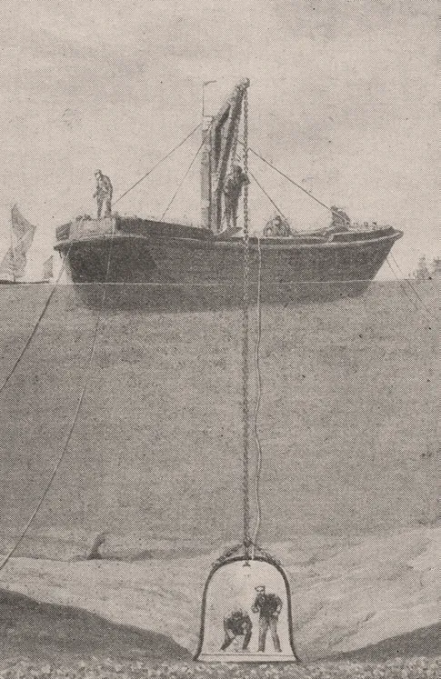

Джеймса Юрена, Николаса Ричардса и Саймона Полглейза) и идёт из жилья рабочих (см. «Жильё рабочих», с. 25) к ближней пристани, где причалена баржа с водолазным колоколом.

Нилл пригласит сыщиков с собой, только если во время разговора они убедили его в своих добрых намерениях. Если сыщики подозревают Нилла, они могут проследить за англичанами на озере, чтобы узнать, что те затевают. К этому времени у Нилла уже изрядная паранойя, так что любая попытка следовать за группой потребует успешных проверок **Скрытности**.

### Снова на озере

Добравшись до баржи с водолазным колоколом, группа поднимается на борт и готовится к отплытию. Через несколько минут англичане отталкиваются длинными шестами и берут курс на середину Харлеммермера. Если сыщики хотят последовать за ними, у пристани есть гребные лодки. На озере много других лодок, так что, если сыщики не подойдут совсем близко, англичане их не заметят.

Дует слабый западный ветер, поверхность озера рябит мелкими волнами. Через полтора часа на вёслах баржа добирается до туманной банки и заходит в неё. Тут же ветер усиливается, волны становятся выше, вздымаются гребнями и рассыпаются пеной.

Сыщики, провалившие проверку **МОЩ** при первом выходе на озеро (см. «На озере», с. 14), должны пройти проверку **Рассудка** (1/1d4). Провалившие её теряют сознание и чувствуют, как тёмная сила из-под воды вытягивает из них силы (см. «Ллойгор», с. 33).

В тумане англичане гребут ещё полчаса, после чего Нилл велит остановиться. Сыщики, прошедшие проверку **Ориентирования**, поймут, что обе лодки направляются точно к тому месту, где раньше нашли де Вита (см. с. 14). Баржа бросает якорь, и англичане начинают готовить водолазный колокол.

Нилл забирается в колокол и приглашает сыщиков, если они здесь, присоединиться к нему (места в колоколе хватит всем сыщикам). Двое англичан управляют краном, который опускает колокол в воду, а двое других качают ручной насос, подающий воздух в колокол по длинному шлангу.

### Два дракона

Несколько минут ил, поднятый опустившимся колоколом, оседает, так что поначалу находящиеся внутри не видят ничего, кроме мутной воды. Когда вода проясняется, из мути медленно проступают обломки старого деревянного судна, лежащего на боку на холмистом дне озера. Сыщики видят прогнившую мачту, нос и корму корабля, а также то, что осталось от трюмов. Никаких явных опознавательных знаков не видно, но к этому времени сыщики должны догадаться, что перед ними обломки «Драгон Рохо» (см. «В лачуге де Вита», с. 13).

Если сыщики пройдут проверку **Внимания**, они заметят что-то блестящее в трюме.

Из плоского в остальном дна озера выступают небольшие неровные холмы. Сыщики, прошедшие проверку **Внимания**, поймут, что холмы расположены кругом, в центре которого лежат обломки корабля.

Нилл отдаёт через воздушный шланг несколько резких приказов, и колокол подводят ближе к обломкам. Там сыщики могут получше рассмотреть содержимое трюма и увидеть, что блестят несколько металлических предметов, скрытых в обломках: меч, монеты и несколько украшений. Сыщикам, которые хотят достать эти вещи, нужно пройти обычную проверку **Подводного плавания** или **трудную** проверку **Плавания**.

Подобравшись ближе к холмам, окружающим обломки, сыщик может пройти ещё одну проверку **Внимания**. В случае успеха он поймёт, что это один-единственный холм, выступы которого складываются в очертания свернувшегося змееподобного существа с ясно различимыми головой, хвостом и лапами. Вид очертаний ллойгора требует проверки **Рассудка** (0/1d4). Если сыщики настолько безрассудны, что попытаются тронуть существо, оно проснётся и кое-кем из них позавтракает.

Через несколько минут сыщики в колоколе могут пройти ещё одну проверку **Внимания**. В случае успеха они на краткий миг увидят, как на дне озера появляется тень размером с человека. Вскоре после этого под колоколом вдруг появляется Виллем ван Кортландт и тут же вонзает Ниллу в грудь длинный острый клинок. Убитый на месте Нилл опускается на дно, а ван Кортландт быстро уплывает, двигаясь в воде куда быстрее, чем под силу человеку. Свидетели жестокой смерти Нилла проходят проверку **Рассудка** (0/1d4). Те, кто остался наверху, слышат звуки нападения через воздушный шланг.

Разделавшись с Ниллом, ван Кортландт берётся за баржу и прорубает катаной несколько дыр в её корпусе. Баржа начинает набирать воду и медленно тонуть; тем, кто ещё на борту, нужно пройти проверку **Плавания** или перебраться в маленькую гребную лодку, привязанную к корме. Сыщики в водолазном колоколе рискуют оказаться погребёнными в огромном чугунном гробу; чтобы избежать этой участи, им нужно покинуть колокол, прежде чем он опустится на дно.

Потопив баржу, ван Кортландт плывёт обратно к берегу — как раз к открытию станции Круквиус (см. ниже). Сыщики, скорее всего, гонятся за ним по пятам.
