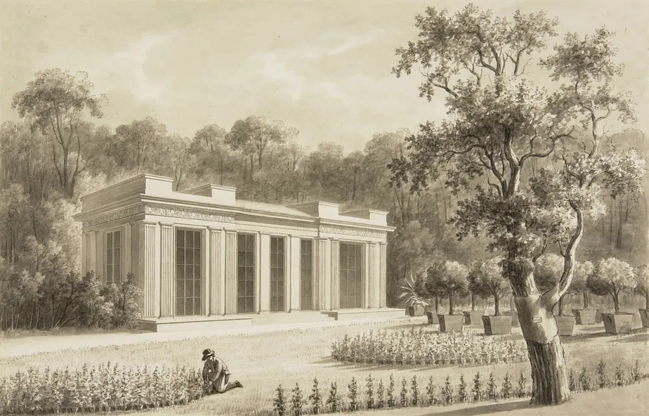

## Открытие станции Круквиус

Торжественная церемония открытия насосной станции Круквиус, на которую приглашены сыщики, должна пройти в Оранжерее замка Хемстеде (см. «Итоги», с. 15) — оттуда открывается чудесный вид на станцию, стоящую на другом берегу Кольцевого канала.

Сыщики, которые отправились с Эдвардом Ниллом на вылазку или проследили за ним до середины озера, прибудут к заднему краю владения, следуя по пятам за ван Кортландтом, как описано ниже.

У парадного входа раскатана красная ковровая дорожка, чтобы встретить короля. Камердинер впускает сыщиков и ведёт их через прекрасный сад к Оранжерее в стиле классицизма — изящному зданию в окружении нескольких деревьев. Камердинер рассказывает им распорядок вечера: в половине седьмого с несколькими словами выступит йонкхер, за ним в семь — господин ван Кортландт. Затем инженеры запустят насосы, и станция Круквиус начнёт работу. Господин ван Кортландт даже устроил фейерверк, чтобы отметить этот великолепный миг в истории Нидерландов! После этого гости вернутся в особняк, где в восемь подадут ужин.

Затем дворецкий проводит сыщиков через южную дверь Оранжереи — как раз когда последние лучи солнца пробиваются сквозь большие окна. Северную стену этого здания в одну комнату украшает большой незажжённый камин. Ряды стульев и скамей обращены к кафедре. В первом ряду стоят два золотых трона — надо полагать, для королевской четы. Места сыщиков — в середине или в конце зала, смотря по их общественному положению. Войдя, они увидят немало приглашённых сановников и знатных особ и даже кое-кого узнают — например, премьер-министра графа Схиммелпеннинка.

Король Виллем III и его супруга королева София прибывают в четверть седьмого. Королевскую чету сопровождают пятеро марешоссе (военной полиции) и двое придворных служителей. Сыщики, которые и дальше будут присматриваться к чете, могут пройти проверку **Внимания**. В случае успеха они заметят, что юные служанки, похоже, интересуют короля больше, чем жена, и это, судя по всему, бесконечно раздражает королеву.

Здесь же и йонкхер Геверс ван Эндегест со своей женой, йонквроу Дёйц ван Асенделфт. В зависимости от исхода событий, описанных в предыдущем разделе (см. «Снова в туман», с. 26), скорее всего, ни ван Кортландт, ни Нилл ещё не прибыли на приём. Однако для обоих оставлены места в первом ряду.

**Примечание для Хранителя:** остальная часть раздела описывает события, которые происходят во время открытия, — если только сыщики не вмешаются.

### Речь йонкхера

В половине седьмого йонкхер поднимается на кафедру и просит публику занять места. Он приносит извинения за господина ван Кортландта, которого якобы задержали неотложные дела на станции, но который должен вернуться вовремя, чтобы произнести свою речь.

Йонкхер начинает с благодарности королю и королеве за то, что они почтили церемонию своим присутствием, — это важный знак признательности всем, кто участвует в осушении. Ведь именно дед короля, Виллем I, начал это дело в 1837 году.

Геверс ван Эндегест напоминает публике об открытии десять месяцев назад станции Лехватер, названной в честь Яна Лехватера (1575–1650) — знаменитого архитектора, строителя мельниц, инженера и одного из первых, кто всерьёз задумался об осушении Харлеммермера: его первоначальный план предусматривал постройку 200 ветряных мельниц вместо всего лишь нескольких паровых станций. Публика посмеивается.

Пока йонкхер продолжает, сыщики могут пройти **трудную** проверку **Внимания**. В случае успеха они заметят, что к берегу озера у станции Круквиус направляется какое-то крупное млекопитающее. Может быть, тюлень — хотя Харлеммермер для них не обычное место обитания.

**Примечание для Хранителя:** это не тюлень, а ван Кортландт, который стремительно плывёт обратно к берегу после нападения на Нилла и/или сыщиков.
