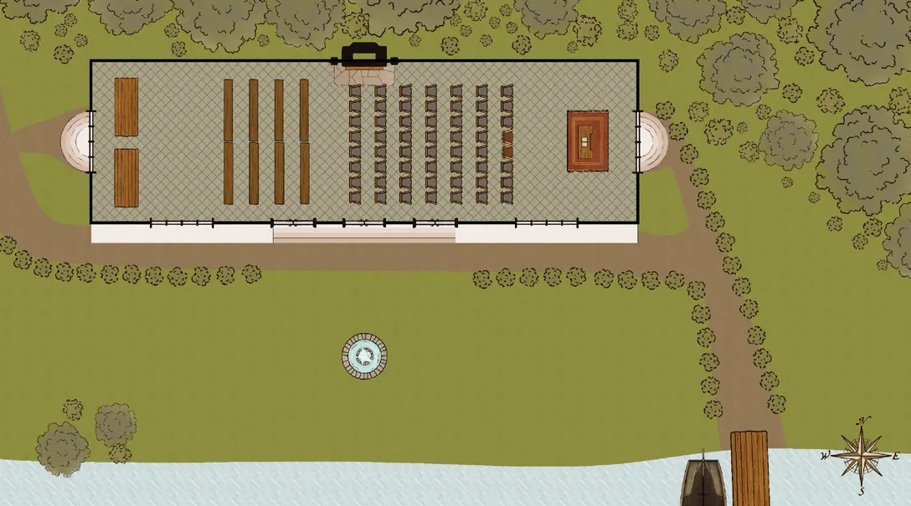

Затем йонкхер переходит к станции Линден, открытой всего 18 дней назад и названной в честь барона Линдена ван Хеммена. Его трактат об осушении Харлеммермера заложил основу работ, которые велись последние двенадцать лет. Сам барон скончался четыре года назад, но его 60-летний сын встаёт и с благодарностью кланяется. Публика аплодирует, но вскоре начинает выказывать первые признаки скуки. Сыщики могут заметить, как король довольно откровенно зевает, за что получает от жены резкий тычок локтем.

Наконец йонкхер говорит о станции Круквиус, названной в честь Николаса Круика, или Круквиуса (1678–1754), — землемера, картографа, астронома и одного из отцов современной метеорологии. Именно Круквиус установил, что ключом к осушению огромного озера станет шлюз в Катвейке.

В этот момент сыщики видят гребную лодку, которая идёт от станции к спуску позади особняка. В ней ван Кортландт и Дату. Они причаливают, сходят на берег и входят в Оранжерею через восточный вход за кафедрой. Войдя, ван Кортландт занимает своё место в первом ряду. Если сыщики шли за ним следом, они прибудут вскоре после него.

Незадолго до семи йонкхер заканчивает речь и приглашает ван Кортландта на кафедру.

### Речь ван Кортландта

Встав за кафедру, ван Кортландт извиняется за опоздание и благодарит короля, королеву и собравшихся сановников за их присутствие. Он достаёт из кармана часы и начинает отсчитывать секунды до семи. Когда стрелки минуют семь, публика слышит со станции Круквиус резкий свисток, и восемь рычагов тут же приходят в движение — сперва медленно, но через несколько секунд станция уже работает в полную силу. Собравшиеся в Оранжерее разражаются аплодисментами и криками «ура».

Ван Кортландт поднимает руки, прося тишины. Это радостное событие, продолжает он, напоминает ему стихотворение, которое он когда-то прочёл в Японии. И он начинает декламировать стихи…

**Примечание для Хранителя:** теперь, когда все три насосные станции работают, ван Кортландт намерен пробудить ллойгора от оцепенения, прочитав ритуал из «Книги мифов и легенд». Чтобы завершить его, ему понадобится пять раундов.

Сыщики могут вмешаться по-разному. Проще всего — застрелить ван Кортландта, хотя марешоссе наверняка расценят это как покушение на королевскую чету и ответят соответственно. Более того, ван Кортландт продолжит ритуал, если только не будет смертельно ранен. Если сыщики бросятся к первым рядам, это тоже привлечёт внимание марешоссе, но успешная проверка **СИЛ** позволит растолкать их, а проверка **Красноречия** — отвлечь охрану.

#### Раунд 1

- Поначалу ван Кортландт читает «стихотворение» тихим шёпотом.
- Сыщики, прошедшие проверку **Внимания**, замечают синий свет, исходящий от станции Круквиус.

#### Раунд 2

- Теперь ван Кортландт говорит обычным голосом. Сыщики, прошедшие проверку **Слуха** и знающие это слово, узнают слова «Вата-цуми».
- Синий свет от станции Круквиус теперь ясно виден всем в Оранжерее. Он разросся в полупрозрачную синюю сферу, окутывающую всю станцию, и продолжает быстро расти. Публика ахает от восхищения: некоторые гости, видимо, уверены, что сейчас увидят обещанный фейерверк.

