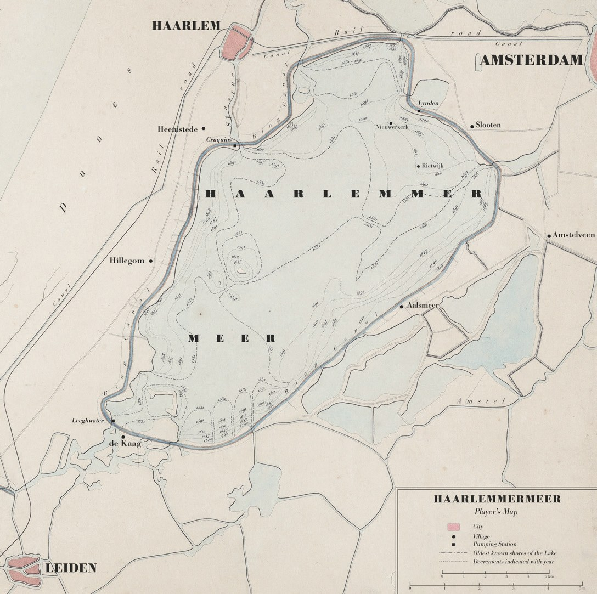

# Приложение B: раздатки для игроков

## Раздатка 1: карта игроков

> **Раздатка 1: карта игроков**
>
> Подписи на карте: HAARLEM — Харлем; AMSTERDAM — Амстердам; LEIDEN — Лейден; Heemstede — Хемстеде; Cruquius — Круквиус; Lynden — Линден; Leeghwater — Лехватер; Slooten — Слотен; Nieuwerkerk — Ньиверкерк; Rietwijk — Ритвейк; Hillegom — Хиллегом; Amstelveen — Амстелвен; Aalsmeer — Алсмер; de Kaag — Кааг; HAARLEMMER MEER — Харлеммермер; Spaarne — Спарне; Amstel — Амстел; Ring Canal — Кольцевой канал; Canal — канал; Rail road — железная дорога; Dunes — дюны.
