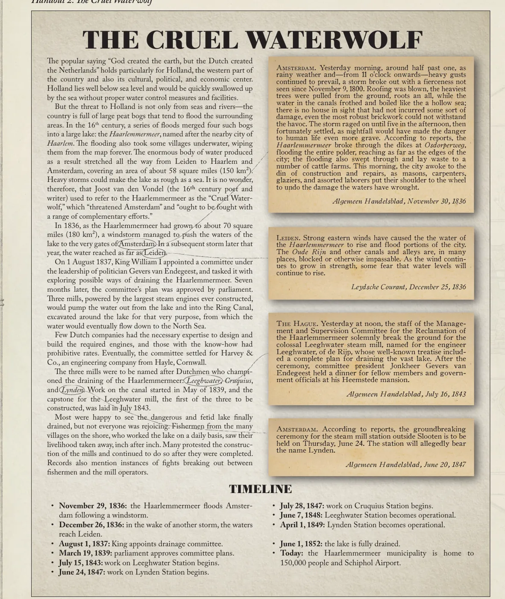

## Раздатка 2: Жестокий Водяной волк

> **Раздатка 2: Жестокий Водяной волк**
>
> **ЖЕСТОКИЙ ВОДЯНОЙ ВОЛК**
>
> Поговорка «Бог создал землю, а голландцы — Нидерланды» особенно верна для Голландии — западной части страны и её культурного, политического и экономического центра. Голландия лежит намного ниже уровня моря, и без надёжных защитных сооружений море быстро поглотило бы её.
>
> Но Голландии грозят не только моря и реки: страна полна больших торфяных болот, которые нередко затопляют окрестности. В XVI веке череда наводнений слила четыре таких болота в одно большое озеро — Харлеммермер, названное по соседнему городу Харлему. Наводнения поглотили и несколько деревень, навсегда стерев их с карты. Получившаяся огромная водная гладь протянулась от Лейдена до Харлема и Амстердама и заняла около 150 км². В сильный шторм озеро становилось бурным, как море. Неудивительно, что Йост ван ден Вондел (поэт и писатель XVI века) называл Харлеммермер «Жестоким Водяным волком», который «грозит Амстердаму» и с которым «следует бороться целым рядом согласованных мер».
>
> В 1836 году, когда Харлеммермер разросся примерно до 180 км², ураган пригнал воды озера к самым воротам Амстердама. В новый шторм в том же году вода дошла до Лейдена.
>
> 1 августа 1837 года король Виллем I назначил комитет под руководством политика Геверса ван Эндегеста и поручил ему изучить, как осушить Харлеммермер. Семь месяцев спустя парламент одобрил план комитета. Три станции с крупнейшими из когда-либо построенных паровых машин должны были откачивать воду из озера в Кольцевой канал, вырытый вокруг озера нарочно для этого, а оттуда вода в конце концов уходила бы в Северное море.
>
> Немногие нидерландские компании обладали нужным опытом, чтобы спроектировать и построить такие машины, а те, кто умел, запрашивали непомерную цену. В конце концов комитет остановился на «Харви и Ко» — инженерной компании из Хейла (Корнуолл).
>
> Три станции назвали в честь нидерландцев, ратовавших за осушение Харлеммермера: Лехватер, Круквиус и Линден. Работы на канале начались в мае 1839 года, а первый камень Лехватера — первой из трёх станций — заложили в июле 1843 года.
>
> Большинство радовалось, что опасное и зловонное озеро наконец осушат, но ликовали не все. Рыбаки многочисленных прибрежных деревень, каждый день кормившиеся озером, видели, как у них шаг за шагом отнимают средства к жизни. Многие протестовали против постройки станций и продолжали протестовать после их завершения. В записях упоминаются и драки между рыбаками и операторами станций.
>
> *Амстердам.* Вчера около половины второго ночи, при дождливой погоде и — с 11 часов — сильных порывах ветра, разразилась буря такой свирепости, какой не видели с 9 ноября 1800 года. Срывало кровлю, самые толстые деревья вырывало с корнями, а вода в каналах пенилась и кипела, как бурное море; не видно ни одного дома, который не получил бы тех или иных повреждений, — не устояла даже самая прочная кладка. Буря бушевала до пяти часов пополудни и, к счастью, утихла: с наступлением ночи опасность для жизни людей стала бы ещё серьёзнее. По сообщениям, Харлеммермер прорвал дамбы у Осдорпервега, затопив весь польдер до самых окраин города; вода прошлась и по нескольким скотным фермам, опустошив их. Этим утром город проснулся под шум стройки и починки: каменщики, плотники, стекольщики и всевозможные работники взялись за дело, чтобы исправить то, что натворила вода.
>
> — «Алгемен Хандельсблад», 30 ноября 1836 года
>
> *Лейден.* Сильные восточные ветры подняли воду Харлеммермера, и она затопила часть города. Старый Рейн и другие каналы и переулки во многих местах перекрыты или непроходимы. Ветер продолжает крепнуть, и есть опасения, что уровень воды будет расти.
>
> — «Лейдсе курант», 25 декабря 1836 года
>
> *Гаага.* Вчера в полдень сотрудники Комитета по управлению и надзору за осушением Харлеммермера торжественно начали работы на месте колоссальной паровой станции «Лехватер», названной в честь инженера Лехватера из Де-Рейпа, чей известный трактат содержал полный план осушения обширного озера. После церемонии председатель комитета йонкхер Геверс ван Эндегест дал обед для членов комитета и государственных чиновников в своём особняке в Хемстеде.
>
> — «Алгемен Хандельсблад», 16 июля 1843 года
>
> *Амстердам.* По сообщениям, церемония начала работ на паровой насосной станции у Слотена состоится в четверг, 24 июня. Станция, как говорят, будет носить имя Линден.
>
> — «Алгемен Хандельсблад», 20 июня 1847 года
>
> **ХРОНОЛОГИЯ**
>
> - 29 ноября 1836 года: после урагана Харлеммермер затопляет Амстердам.
> - 26 декабря 1836 года: после нового шторма вода доходит до Лейдена.
> - 1 августа 1837 года: король назначает комитет по осушению.
> - 19 марта 1839 года: парламент одобряет план комитета.
> - 15 июля 1843 года: начаты работы на станции Лехватер.
> - 24 июня 1847 года: начаты работы на станции Линден.
> - 28 июля 1847 года: начаты работы на станции Круквиус.
> - 7 июня 1848 года: станция Лехватер начинает работу.
> - 1 апреля 1849 года: станция Линден начинает работу.
> - 1 июня 1852 года: озеро полностью осушено.
> - Сегодня: в общине Харлеммермер живут 150 000 человек, здесь находится аэропорт Схипхол.

*Прим. перев.:* так в оригинале — «семь месяцев спустя» (по хронологии план одобрен 19 марта 1839 года) и заметка «Лейдсе курант» от 25 декабря 1836 года о наводнении, которое по хронологии случилось 26 декабря.
