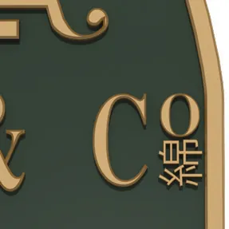
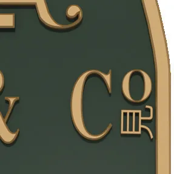
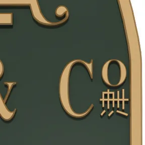
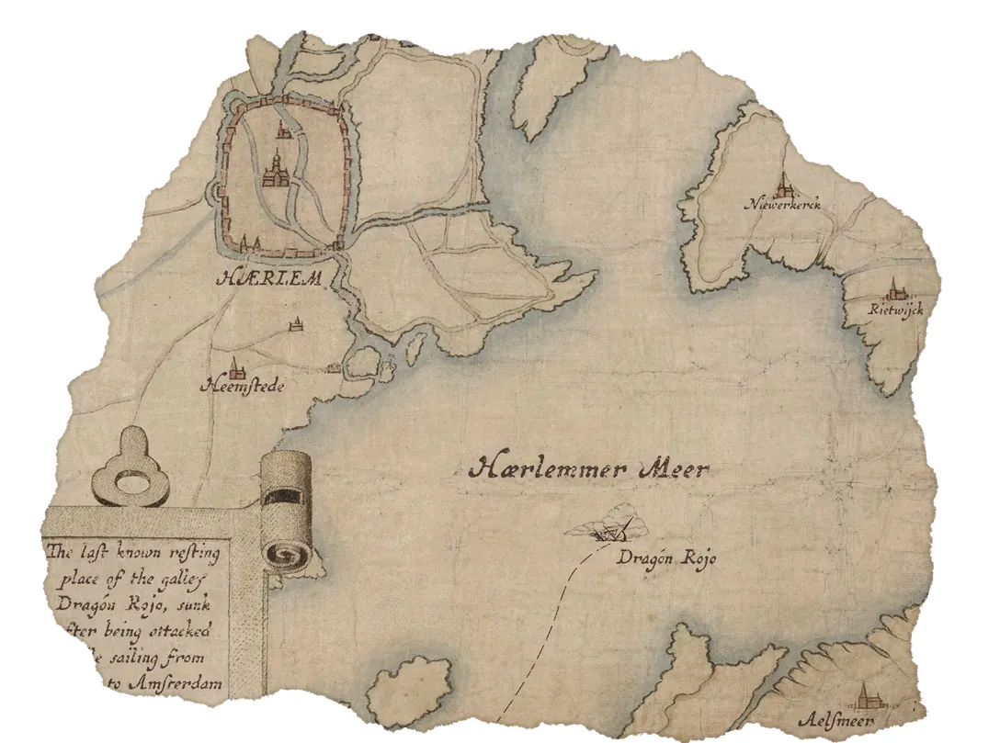

## Раздатка 3: знак Линдена

> **Раздатка 3: знак Линдена**
>
> …& Co 綿 (иероглиф на заводской табличке)

## Раздатка 6: знак Лехватера

> **Раздатка 6: знак Лехватера**
>
> …& Co 見 (иероглиф на заводской табличке)

## Раздатка 7: знак Круквиуса

> **Раздатка 7: знак Круквиуса**
>
> …& Co 津 (иероглиф на заводской табличке)

## Раздатка 4: старая карта де Вита

> **Раздатка 4: старая карта де Вита**
>
> Подписи на карте: Hærlem — Харлем; Heemstede — Хемстеде; Nieuwerkerck — Ньиверкерк; Rietwijck — Ритвейк; Hærlemmer Meer — Харлеммермер; Dragón Rojo — «Драгон Рохо»; Aelsmeer — Алсмер.
>
> Надпись на свитке: «Последнее известное место упокоения галеры „Драгон Рохо“, затонувшей …после нападения, …когда она шла из … в Амстердам» (часть текста закрыта рисунком).
