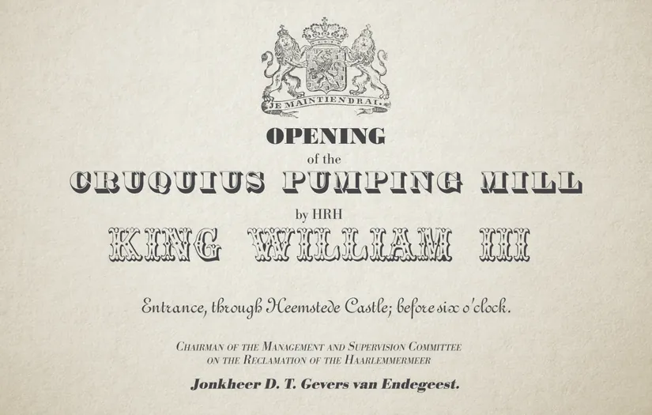
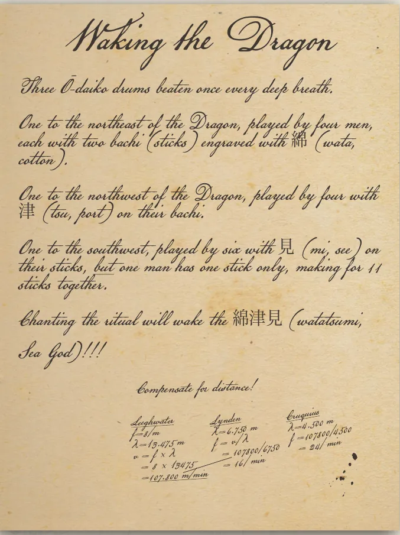

## Раздатка 5: приглашение на открытие Круквиуса

> **Раздатка 5: приглашение на открытие Круквиуса**
>
> JE MAINTIENDRAI («Я сохраню» — девиз королевского дома)
>
> **ОТКРЫТИЕ**
>
> насосной станции
>
> **КРУКВИУС**
>
> Его Королевским Высочеством
>
> **КОРОЛЁМ ВИЛЛЕМОМ III**
>
> Вход — через замок Хемстеде, до шести часов.
>
> Председатель Комитета по управлению и надзору за осушением Харлеммермера
>
> йонкхер Д. Т. Геверс ван Эндегест.

## Раздатка 8: Пробуждение дракона

> **Раздатка 8: Пробуждение дракона**
>
> **Пробуждение дракона**
>
> Три барабана о-дайко, бить раз на каждый глубокий вдох.
>
> Один — к северо-востоку от Дракона, бьют четверо, у каждого по две бати (палочки) с вырезанным 綿 (вата, хлопок).
>
> Один — к северо-западу от Дракона, бьют четверо с 津 (цу, гавань) на бати.
>
> Один — к юго-западу, бьют шестеро с 見 (ми, видеть) на палочках, но у одного только одна палочка — всего 11 палочек.
>
> Пение обряда разбудит 綿津見 (ватацуми, Бога моря)!!!
>
> *Выровнять расстояние!*
>
> Лехватер: f = 8/мин; λ = 13,475 м; v = f × λ = 8 × 13475 = 107 800 м/мин
>
> Линден: λ = 6,750 м; f = v/λ = 107800/6750 = 16/мин
>
> Круквиус: λ = 4,500 м; f = 107800/4500 = 24/мин
