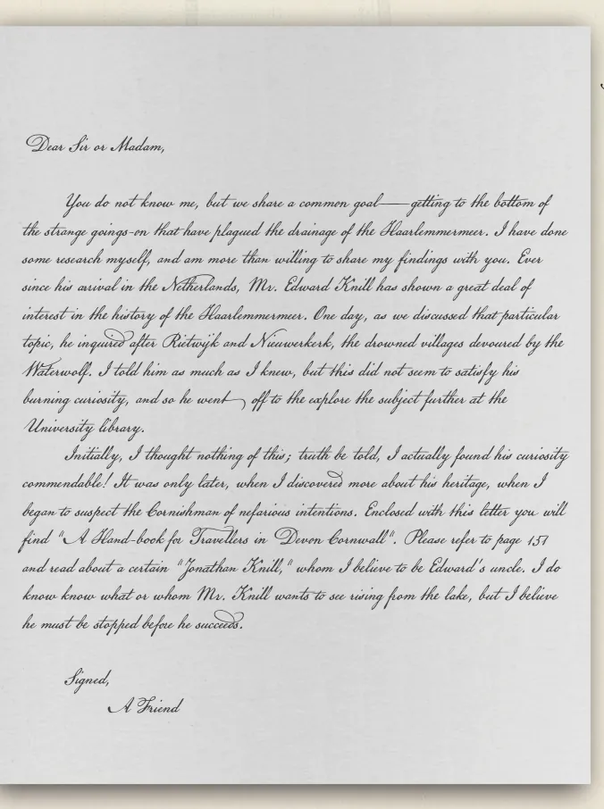
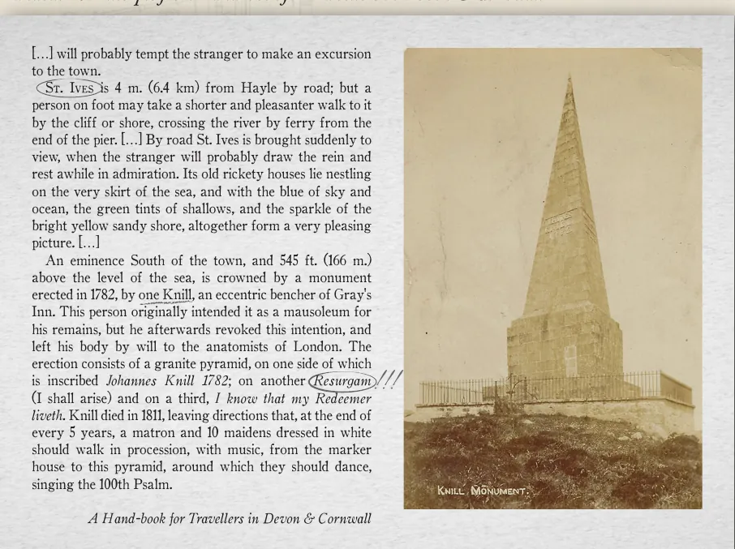

## Раздатка 9: анонимное письмо

> **Раздатка 9: анонимное письмо**
>
> Уважаемый сэр или мадам!
>
> Вы меня не знаете, но у нас общая цель — докопаться до сути странных происшествий, преследующих осушение Харлеммермера. Я и сам кое-что разузнал и охотно поделюсь с вами находками. С самого приезда в Нидерланды мистер Эдвард Нилл проявлял большой интерес к истории Харлеммермера. Однажды, когда мы говорили об этом, он расспрашивал о Ритвейке и Ньиверкерке — затонувших деревнях, которые поглотил Водяной волк. Я рассказал всё, что знал, но его жгучего любопытства это не утолило, и он отправился изучать предмет дальше в университетскую библиотеку.
>
> Поначалу я не придал этому значения; по правде говоря, его любознательность даже показалась мне похвальной! Лишь позже, узнав больше о его происхождении, я стал подозревать корнуоллца в дурных намерениях. К письму прилагаю «Путеводитель для путешественников по Девону и Корнуоллу». Прошу вас открыть страницу 151 и прочесть о некоем «Джонатане Нилле», которого я считаю дядей Эдварда. Не знаю, что или кого мистер Нилл хочет увидеть восставшим из озера, но полагаю, что его нужно остановить, пока он не преуспел.
>
> Подпись:
>
> Друг

## Раздатка 10: выдержки из «Путеводителя для путешественников по Девону и Корнуоллу»

> **Раздатка 10: выдержки из «Путеводителя для путешественников по Девону и Корнуоллу»**
>
> […] наверняка соблазнит путешественника съездить в город.
>
> Сент-Айвс в 6,4 км от Хейла по дороге; но пешеход может выбрать путь короче и приятнее — по утёсам или берегу, переправившись через реку на пароме от конца пристани. […] С дороги Сент-Айвс открывается внезапно, и путешественник, верно, натянет поводья и на время остановится полюбоваться. Его старые шаткие домики жмутся к самой кромке моря, и вместе с синевой неба и океана, зеленоватыми отмелями и блеском ярко-жёлтого песчаного берега всё это складывается в очень приятную картину. […]
>
> Возвышенность к югу от города, в 166 м над уровнем моря, венчает памятник, воздвигнутый в 1782 году неким Ниллом, эксцентричным бенчером Грейс-Инн. Он задумывал его как мавзолей для своих останков, но потом отказался от этого намерения и завещал тело лондонским анатомам. Сооружение — гранитная пирамида; на одной её стороне высечено «Johannes Knill 1782», на другой — «Resurgam» («Я воскресну»), на третьей — «I know that my Redeemer liveth» («Я знаю, что мой Искупитель жив»). Нилл умер в 1811 году, оставив распоряжение, чтобы по истечении каждых 5 лет матрона и 10 девушек в белом шествовали с музыкой от рыночного дома к этой пирамиде и танцевали вокруг неё, распевая 100-й псалом.
>
> [на полях у фотографии шпиля — пометка «!!!»]
>
> — «Путеводитель для путешественников по Девону и Корнуоллу»
