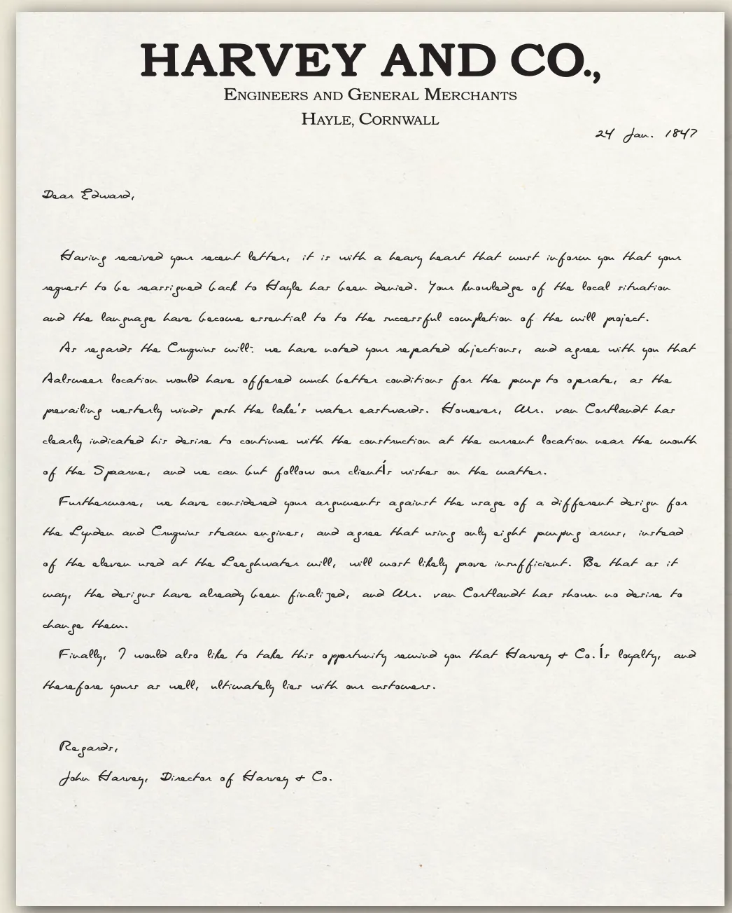

## Раздатка 11: письмо Эдварду Ниллу

> **Раздатка 11: письмо Эдварду Ниллу**
>
> «ХАРВИ И КО», ИНЖЕНЕРЫ И ОБЩИЕ ТОРГОВЦЫ
>
> ХЕЙЛ, КОРНУОЛЛ
>
> 24 янв. 1847
>
> Дорогой Эдвард!
>
> Получив ваше недавнее письмо, с тяжёлым сердцем вынужден сообщить, что в вашей просьбе о переводе обратно в Хейл отказано. Ваше знание местных обстоятельств и языка стало необходимым для успешного завершения работ на станциях.
>
> Что до Круквиуса: мы приняли к сведению ваши неоднократные возражения и согласны с вами, что место у Алсмера дало бы насосу куда лучшие условия, поскольку преобладающие западные ветры гонят воду озера на восток. Однако мистер ван Кортландт ясно дал понять, что желает продолжать постройку на нынешнем месте, у устья Спарне, и мы можем лишь следовать воле клиента.
>
> Кроме того, мы рассмотрели ваши доводы против иной конструкции машин Линдена и Круквиуса и согласны, что восьми насосных рычагов вместо одиннадцати, как на Лехватере, скорее всего, окажется недостаточно. Как бы то ни было, проекты уже утверждены, и мистер ван Кортландт не выказал желания их менять.
>
> Наконец, пользуюсь случаем напомнить вам, что верность «Харви и Ко», а значит и ваша, в конечном счёте принадлежит нашим заказчикам.
>
> С уважением,
>
> Джон Харви, директор «Харви и Ко»

*Прим. перев.:* здесь письмо датировано 24 января 1847 года, а в тексте главы (с. 24) — 24 сентября 1845 года; так в оригинале.
