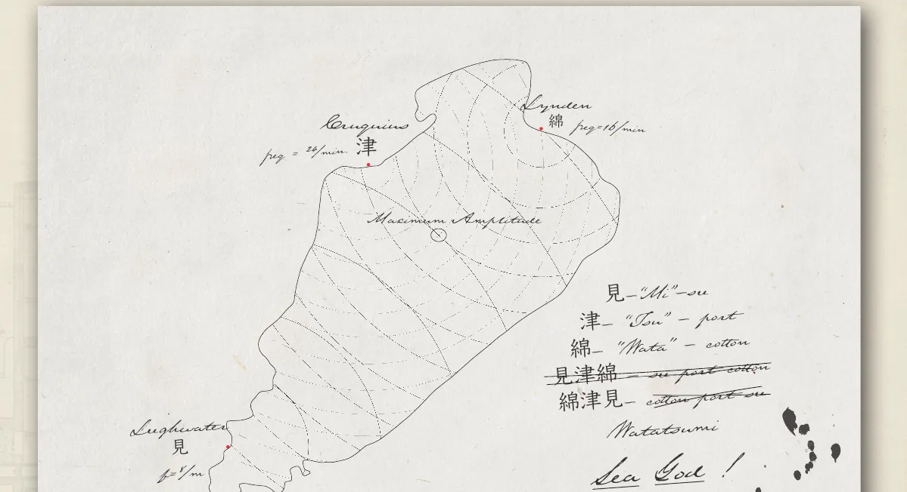

## Раздатка 12: записи Нилла

> **Раздатка 12: записи Нилла**
>
> [набросок Харлеммермера с тремя станциями и расходящимися от них волнами]
>
> Круквиус 津 частота = 24/мин.
>
> Линден 綿 частота = 16/мин
>
> Лехватер 見 f = 8/мин
>
> Максимальная амплитуда
>
> 見 — «ми» — видеть
>
> 津 — «цу» — гавань
>
> 綿 — «вата» — хлопок
>
> 見津綿 — (зачёркнуто: видеть гавань хлопок)
>
> 綿津見 — (зачёркнуто: хлопок гавань видеть) Ватацуми
>
> Бог моря!

# Приложение C: заклинания

## Дыхание каппы

- **Стоимость:** 6 магических пунктов; 1 пункт Рассудка
- **Время сотворения:** 2 раунда

Это заклинание японского происхождения связано с каппами — расой земноводных вампиров, которых считают ответвлением глубоководных. В «Семи сокровенных книгах Хсана» сказано, что каппы могут дарить своё дыхание, позволяя получившему его дышать под водой. Говорят, заклинание повторяет это действие.

Заклинание действует двенадцать часов (если получивший его к тому времени всё ещё под водой, он начинает тонуть), но его можно продлить, снова заплатив цену. Получивший этот дар должен пройти проверку **Рассудка** (потеря 1/1d4), когда понимает, что по обе стороны шеи у него выросли жабры.

Текст предупреждает, что долгое пользование этим даром превращает получившего его в каппу. Каждый раз, когда заклинание продлевают или применяют снова, цель должна пройти проверку **ВЫН**: при провале действие заклинания становится постоянным и цель больше не может дышать воздухом (жабры остаются навсегда), что по указанию Хранителя влечёт дальнейшие потери Рассудка (рекомендуется терять 1+ пункт Рассудка в день, пока Рассудок не дойдёт до нуля). Другие телесные изменения — также на усмотрение Хранителя.

## Связь с тацу

- **Стоимость:** 9 магических пунктов; 1d3 пункта Рассудка
- **Время сотворения:** 5 раундов

Если только поблизости вообще есть тацу (драконы), песнопение удаётся само собой. Для обряда нужно около 0,14 м³ той стихии, к которой тяготеет нужный тацу (огонь — для кадзу-цути, воздух — для небесных тацу, вода — для вата-цуми), в большой жаровне. Вокруг жаровни поют, а стихию в ней приводят в движение. Кроме того, заклинание лучше всего действует рядом с большим объёмом родной стихии — например, у вулкана, в горном воздухе или у чистого озера.

## Пробуждение тацу

- **Стоимость:** 12 магических пунктов; 1d6 пунктов Рассудка
- **Время сотворения:** 5 раундов

Это уникальное заклинание из «Книги мифов и легенд Японии» (см. «Secrets of Japan», с. 132), позволяющее пробудить дракона (тацу) от оцепенения. Силу обряду даёт бой огромных барабанов о-дайко, на каждом из которых вырезан один из иероглифов имени дракона и которые расставлены вокруг дракона. Когда обряд совершён, звук барабанов пробуждает существо ото сна.
